# Cas d'utilisation et scénarios des vues Vaadin

Documentation fonctionnelle des 24 vues du module `recordz-web` (package `com.example.recordz.ui`), établie par lecture du code source. Chaque cas d'utilisation décrit l'acteur, les préconditions, le scénario nominal, les scénarios alternatifs et d'erreur, et les postconditions.

Pour l'architecture technique, voir [diagrammes.md](diagrammes.md) ; pour les tables manipulées, voir [modele-de-donnees.md](modele-de-donnees.md).

## Navigation

| Page | Vues couvertes | Cas d'utilisation |
|---|---|---|
| [Accès et navigation](cas-d-utilisation/01-acces-et-navigation.md) | `MainLayout`, `LoginView`, `MainView`, `AProposView`, `TarifView`, `NouvelUtilisateurView` | UC-01 à UC-07 |
| [Catalogue et recherche](cas-d-utilisation/02-catalogue-et-recherche.md) | `CategorieView`, `CatalogueView`, `ResultatsRechercheView` | UC-10 à UC-13 |
| [Fiche article et offres](cas-d-utilisation/03-fiche-article-et-offres.md) | `DetailArticleView` | UC-20 à UC-27 |
| [Publier et promouvoir une annonce](cas-d-utilisation/04-publier-et-promouvoir.md) | `ArticleFormView`, `DynamicArticleForm`, `FairePublicite` | UC-30 à UC-31 |
| [Mon compte : paiements, livraisons, notes](cas-d-utilisation/05-mon-compte-transactions.md) | `MonCompteView`, `EncheresView` | UC-40 à UC-48 |
| [Profils, informations et calendrier](cas-d-utilisation/06-profils-et-compte.md) | `InformationsPersonnellesView`, `ProfilView`, `ProfilVendeurView`, `CalendrierView`, `OtherViews`, `TestUi` | UC-50 à UC-55 |
| [Points d'attention](cas-d-utilisation/07-points-d-attention.md) | Toutes | Synthèse des anomalies classées |

## Acteurs

| Acteur | Définition dans le code |
|---|---|
| **Visiteur anonyme** | Non authentifié. Peu de vues lui sont ouvertes (voir ci-dessous). |
| **Utilisateur connecté** | Authentifié par Google OAuth2 (principal `OidcUser`), identifié par son e-mail. Il n'existe ni rôle ni administrateur dans le code des vues. |
| **Acheteur** | Rôle d'un utilisateur connecté dans une transaction (`a_paye.ref_acheteur`, `a_livre.ref_acheteur`). |
| **Vendeur** | Rôle d'un utilisateur connecté qui met un article en vente (`met_en_vente.ref_vendeur`). |
| **Système** | `EnchereScheduler` (clôture des enchères), webhook Entrupy, envoi d'e-mails. |

Un même compte joue le rôle d'acheteur ou de vendeur selon la ligne de la transaction concernée.

### Accès anonyme

La plupart des vues sont annotées `@PermitAll` : un visiteur anonyme est redirigé vers `/login`. Seules sont accessibles sans connexion :

| Vue | Annotation |
|---|---|
| `LoginView` (`/login`) | `@AnonymousAllowed` |
| `CategorieView` (`/categorie/{id}`) | `@AnonymousAllowed` |
| `AProposView` (`/a-propos`) | `@AnonymousAllowed` |
| `MainLayout` | `@AnonymousAllowed` (le cadre, pas son contenu) |

L'accueil (`MainView`), la fiche article (`DetailArticleView`) et les tarifs sont en `@PermitAll`. Le code de la fiche article prévoit pourtant des messages « connectez-vous » pour un visiteur, ce qui suggère une intention d'accès anonyme que les annotations ne permettent pas. Voir les [points d'attention](cas-d-utilisation/07-points-d-attention.md).

## Vue d'ensemble des cas d'utilisation

```mermaid
flowchart LR
    VIS(["Visiteur anonyme"])
    USR(["Utilisateur connecté"])
    ACH(["Acheteur"])
    VEN(["Vendeur"])

    subgraph ACCES["Accès et navigation"]
        UC01["UC-01 Se connecter avec Google"]
        UC02["UC-02 Changer la langue"]
        UC03["UC-03 Rechercher depuis la barre"]
        UC04["UC-04 Parcourir l'accueil"]
        UC05["UC-05 Consulter À propos"]
        UC06["UC-06 Consulter les tarifs"]
    end

    subgraph CATA["Catalogue"]
        UC10["UC-10 Parcourir par catégorie"]
        UC11["UC-11 Recherche avancée"]
    end

    subgraph FICHE["Fiche article"]
        UC20["UC-20 Consulter la fiche"]
        UC23["UC-23 Poser une question"]
        UC24["UC-24 Faire une offre"]
        UC25["UC-25 Acheter"]
        UC26["UC-26 Demander une visite"]
    end

    subgraph DEPOT["Annonces"]
        UC30["UC-30 Publier une annonce"]
        UC31["UC-31 Mettre en avant"]
    end

    subgraph COMPTE["Mon compte"]
        UC40["UC-40 Confirmer mon paiement"]
        UC41["UC-41 Confirmer le paiement reçu"]
        UC42["UC-42 Confirmer l'expédition"]
        UC43["UC-43 Confirmer la réception"]
        UC44["UC-44 Retrait sur place"]
        UC45["UC-45 Noter un achat"]
        UC46["UC-46 Suivre ventes et achats"]
        UC50["UC-50 Modifier mes informations"]
        UC51["UC-51 Consulter un profil"]
        UC53["UC-53 Consulter mon calendrier"]
    end

    VIS --> UC01
    VIS --> UC05
    VIS --> UC10
    VIS --> UC11
    USR --> UC02
    USR --> UC03
    USR --> UC04
    USR --> UC06
    USR --> UC20
    USR --> UC23
    USR --> UC26
    USR --> UC46
    USR --> UC50
    USR --> UC51
    ACH --> UC24
    ACH --> UC25
    ACH --> UC40
    ACH --> UC43
    ACH --> UC44
    ACH --> UC45
    VEN --> UC30
    VEN --> UC31
    VEN --> UC41
    VEN --> UC42
    VEN --> UC44
    VEN --> UC53
```

## Carte de navigation

Les libellés de menu sont des clés de traduction : le texte affiché dépend du fichier de ressources, non analysé ici.

| Route | Vue | Accès | Point d'entrée |
|---|---|---|---|
| `/` et `/{page}` | `MainView` | connecté | menu `nav.home`, redirection après connexion |
| `/login` | `LoginView` | anonyme | redirection automatique depuis une vue protégée |
| `/categorie/{id}` | `CategorieView` | anonyme | tiroir des catégories, barre de recherche |
| `/catalogue` | `CatalogueView` | connecté | aucun lien trouvé |
| `/recherche` | `ResultatsRechercheView` | non annoté | aucun lien trouvé (maquette) |
| `/detail/{id}` | `DetailArticleView` | connecté | liste d'accueil, catégories, profils |
| `/ajouter-article` | `ArticleFormView` | connecté | navigation secondaire du compte |
| `/publicite` | `FairePublicite` | connecté | navigation secondaire du compte |
| `/encheres` et `/encheres/{page}` | `EncheresView` | connecté | navigation secondaire du compte |
| `/mon-compte` | `MonCompteView` | connecté | menu `nav.account` |
| `/mon-compte/informations` | `InformationsPersonnellesView` | connecté | navigation secondaire du compte |
| `/calendrier` | `CalendrierView` | connecté | navigation secondaire du compte |
| `/profil/{username}` | `ProfilView` | connecté | aucun lien actif |
| `/vendeur/{username}` | `ProfilVendeurView` | connecté | aucun lien d'entrée (maquette) |
| `/a-propos` | `AProposView` | anonyme | menu `nav.about` |
| `/tarif` | `TarifView` | connecté | menu `nav.pricing` |
| `/nouvel-utilisateur` | `NouvelUtilisateurView` | connecté | aucun lien (maquette) |
| `/mes-annonces`, `/mes-achats`, `/wishlist`, `/boutique` | `OtherViews` | connecté | aucun lien (coquilles) |
| `/test` | `TestUi` | connecté | aucun lien (vue de test) |

Il n'existe aucun lien de connexion ni de déconnexion dans le cadre commun (`MainLayout`) : la connexion se déclenche uniquement par la redirection d'une vue protégée vers `/login`.

## État d'implémentation des vues

| État | Vues |
|---|---|
| Fonctionnelles | `MainLayout`, `LoginView`, `MainView`, `CategorieView`, `DetailArticleView`, `ArticleFormView` et `DynamicArticleForm`, `FairePublicite`, `MonCompteView`, `EncheresView`, `InformationsPersonnellesView`, `ProfilView`, `CalendrierView`, `CatalogueView`, `AProposView`, `TarifView` |
| Fonctionnalité partielle | `ArticleFormView` (panneau vidéo non affiché), `FairePublicite` (pagination défectueuse, aucun paiement) |
| Maquettes ou coquilles | `ResultatsRechercheView` (4 articles en dur), `ProfilVendeurView` (données factices), `NouvelUtilisateurView` (aucun enregistrement), `MesAchatsView`, `WishlistView`, `BoutiqueView` (« Fonctionnalité à venir ») |
| Vue de test | `TestUi` |
| Code mort | `MonCompteHelper` (une méthode privée jamais appelée) |

## Méthode et limites

- Les cas d'utilisation sont déduits du code des vues et, quand c'était nécessaire pour comprendre un appel, de `ArticleService`, `ArticleRepository`, `ArticleSubmitService` et `ReferenceService`. Les comportements indiqués « non vérifié » dépendent de fichiers non lus.
- Les textes affichés sont désignés par leur clé de traduction (par exemple `detail.offer.tooLow`). Les fichiers de ressources n'ont pas été analysés.
- Les statuts numériques (`ref_statut` 7, 8, 9, 12, 14) sont ceux observés dans `MonCompteView` et ses requêtes. Leur signification n'est pas documentée dans le code.
- Ce document décrit l'existant, y compris ses défauts : il ne spécifie pas un comportement cible.
