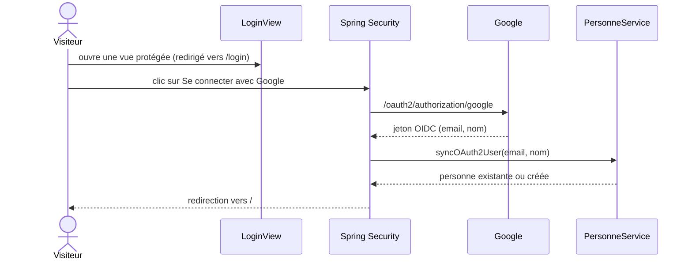

# Accès et navigation

[← Cas d'utilisation](../cas-d-utilisation.md)

Vues couvertes : `MainLayout`, `LoginView`, `MainView`, `AProposView`, `TarifView`, `NouvelUtilisateurView`.

## UC-01 Se connecter avec Google

- **Vue** : `LoginView` (`/login`, `@AnonymousAllowed`, sans layout). Sécurité : `SecurityConfig`, `CustomOAuth2UserService`.
- **Acteur** : visiteur anonyme.
- **Préconditions** : disposer d'un compte Google dont le jeton contient une adresse e-mail.

**Scénario nominal**
1. Le visiteur ouvre une vue protégée. Il est redirigé vers `/login`.
2. La page affiche le logo, « La marketplace suisse » et le bouton « Se connecter avec Google ».
3. Il clique sur le bouton, un lien vers `/oauth2/authorization/google` (le routeur Vaadin est ignoré).
4. Google authentifie l'utilisateur et le renvoie à l'application.
5. `CustomOAuth2UserService.loadUser` lit l'e-mail et le nom complet, puis appelle `personneService.syncOAuth2User(email, nom)`. Un compte `personne` est créé si l'e-mail est inconnu (selon le commentaire du code, la logique est dans le service, non lu).
6. Spring Security redirige vers `/` (`defaultSuccessUrl("/", true)`).

**Alternatives et erreurs**
- Utilisateur déjà connecté qui ouvre `/login` : `beforeEnter` le redirige vers l'accueil.
- Jeton Google sans e-mail : `OAuth2AuthenticationException` (« Email manquant dans le token Google »). Le message affiché à l'utilisateur n'est pas défini dans le code analysé.

**Postconditions** : session authentifiée avec un `OidcUser` ; ligne `personne` existante.

**Remarques**
- La connexion par formulaire n'existe pas : `SecurityConfig` ne déclare pas de `formLogin`.
- La mention des conditions d'utilisation n'a pas de lien.
- Les textes de la page sont en dur, non traduits.
- Il n'existe pas de bouton de déconnexion dans l'interface analysée.

## UC-02 Changer la langue

- **Vue** : `MainLayout`.
- **Acteur** : tout utilisateur.

**Scénario nominal**
1. L'utilisateur ouvre le sélecteur de langue à droite de la barre du haut (Français, English, Deutsch).
2. Il choisit une langue.
3. Le handler stocke la locale en session (clé `app.locale`), appelle `ui.setLocale` et recharge la page.

**Alternatives** : les changements de valeur qui ne viennent pas du client sont ignorés.

**Postcondition** : l'interface est rechargée dans la langue choisie. Le code qui relit `app.locale` au démarrage n'est pas dans les fichiers analysés.

**Remarque** : plusieurs vues affichent des textes en dur en français (`LoginView`, `CatalogueView`, `NouvelUtilisateurView`, `OtherViews`, `TestUi`) et ne suivent donc pas ce choix.

## UC-03 Rechercher depuis la barre de recherche

- **Vue** : `MainLayout` (barre de recherche).
- **Acteur** : tout utilisateur.

**Scénario nominal**
1. L'utilisateur saisit un nom d'article dans le champ « Nom » et peut choisir une catégorie dans la liste (la valeur par défaut « -------- » vaut 0).
2. Il clique sur « Rechercher » ou appuie sur Entrée dans le champ.
3. L'application navigue vers `categorie/{idCat}?nom={nom encodé UTF-8}`, qui affiche les résultats ([UC-10](02-catalogue-et-recherche.md)).

**Alternatives** : aucune validation, une recherche vide est possible (elle ouvre la catégorie sans filtre de nom).

**Remarques** : les libellés « Nom », « Rechercher » et le libellé d'accessibilité du bouton de menu sont en dur alors que des clés de traduction existent.

## UC-04 Parcourir l'accueil

- **Vue** : `MainView` (`/` et `/{page}`, `@PermitAll`).
- **Acteur** : utilisateur connecté.

**Scénario nominal**
1. L'utilisateur arrive sur l'accueil (page 1 par défaut).
2. Le tableau affiche 10 articles (`articleService.findAllTries(page, 10)`) avec image, nom, marque, prix et statut. Un badge `main.promoted` signale les articles dont `pub = 1`.
3. Il navigue avec la pagination (première, précédente, fenêtre de ±2 pages, suivante, dernière).
4. Il clique sur le nom ou sur la ligne pour ouvrir la fiche ([UC-20](03-fiche-article-et-offres.md)).

**Alternatives**
- Liste vide : message `main.empty`. Article sans nom : `main.no.name`.
- Numéro de page nul ou négatif : ramené à 1. Une page au-delà du total n'est pas plafonnée : la liste est vide.

**Remarque** : la vue étant `@PermitAll`, un visiteur anonyme est redirigé vers `/login` avant d'atteindre l'accueil.

## UC-05 Consulter la page À propos

- **Vue** : `AProposView` (`/a-propos`, `@AnonymousAllowed`).
- **Acteur** : tout visiteur.
- **Scénario** : la page affiche un titre (`about.title`) et un texte (`about.propos`). Aucune action n'est possible.

## UC-06 Consulter les tarifs

- **Vue** : `TarifView` (`/tarif`, `@PermitAll`).
- **Acteur** : utilisateur connecté.
- **Scénario** : la page affiche trois lignes : tarif standard, commission « 0% » et mise en avant « 1000 CHF ». Aucune action n'est possible.
- **Remarque** : les valeurs « 0% » et « 1000 CHF » sont en dur. Le menu `nav.pricing` est visible des anonymes mais la vue exige une connexion.

## UC-07 Créer un compte (maquette)

- **Vue** : `NouvelUtilisateurView` (`/nouvel-utilisateur`, `@PermitAll`).
- **Acteur** : prévu pour un visiteur.

**Comportement réel** : le formulaire (nom d'utilisateur, e-mail, mot de passe, confirmation) n'enregistre rien. Le bouton « Créer le compte » navigue simplement vers `login`. Aucune validation, aucun service, aucun e-mail.

**Remarques**
- La vue exige déjà une connexion, ce qui contredit son objectif.
- Aucun lien du menu ni de `LoginView` n'y mène.
- La création d'un compte passe en réalité par la première connexion Google ([UC-01](#uc-01-se-connecter-avec-google)).
