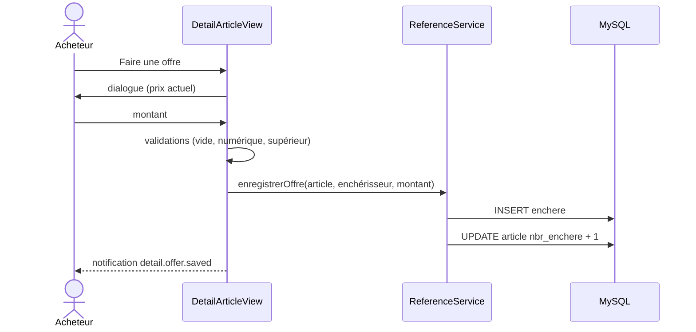

# Fiche article et offres

[← Cas d'utilisation](../cas-d-utilisation.md)

Vue couverte : `DetailArticleView` (`/detail/:articleId`, `@PermitAll`). Le titre est dynamique (`detail.pagetitle`), identique pour tous les articles.

La vue distingue **vente aux enchères** (`enchere > 0`) et **vente directe** (`enchere` nul ou 0). Elle ne tient compte ni de l'état « vendu » ni de la date de fin d'une enchère.

## UC-20 Consulter la fiche d'un article

- **Acteur** : utilisateur connecté.
- **Préconditions** : un identifiant d'article numérique dans l'URL.

**Scénario nominal**
1. La vue lit `articleId` et appelle `articleService.findByIdAndTrackVisit(id)`, qui charge l'article et incrémente son compteur de visites.
2. Si l'utilisateur est connecté, `referenceService.enregistrerVisite` ajoute une ligne dans `article_visite` (nom, prénom, e-mail, date).
3. La vue charge le vendeur (`findIdVendeur`, puis `personneService.findById`).
4. Elle affiche : une image (180 x 120 px, `/images/articles/{pochette}`), les caractéristiques selon la catégorie, la condition de paiement et le mode de livraison, le nombre de visites, le nombre d'enchères (si enchère), le stock, le vendeur (lien vers `/profil/{nomUtilisateur}`), la description, la vidéo YouTube éventuelle et les questions publiques.

**Caractéristiques affichées selon la catégorie**

| Catégorie | Champs |
|---|---|
| Voiture, Moto | chevaux, cylindres, km, année, première immatriculation, carburant, boîte, climatisation |
| Livres | auteur, éditeur, année |
| Immobilier | pièces, surface, terrain, année de construction, adresse, lieu, NPA |
| Mode femme, homme, lingerie | taille |
| Vins | millésime, type de vin, cépage |
| DVD | acteurs, réalisateur, durée, année |
| Jeux | type de jeu |
| Sous-catégorie TV écran plat | dimension, type d'écran |
| Sous-catégories PC | processeur, RAM, disque dur |

**Alternatives et erreurs**
- Identifiant non numérique : message `detail.invalidid`.
- Article introuvable : message `detail.notfound` (pas de code 404 ni de redirection).
- Échec de l'enregistrement de la visite ou du chargement du vendeur : journalisé seulement.

**Postconditions** : `article.visites` incrémenté à chaque affichage (y compris pour le vendeur et les rechargements) ; ligne `article_visite` pour un utilisateur connecté.

**Remarques** : la vue n'offre ni carrousel (une seule image), ni favoris, ni panier, ni partage, ni QR-facture, ni affichage du statut Entrupy.

## UC-21 Voir les derniers enchérisseurs

- **Acteur** : utilisateur connecté. **Précondition** : article en enchère (`enchere > 0`).

**Scénario nominal**
1. La section « Derniers enchérisseurs » liste les offres par pages de 5 (`findDerniersEncherisseurs`), avec boutons précédent et suivant.
2. Chaque ligne affiche un avatar (initiales), le nom, le montant en CHF et la date `dd/MM/yyyy HH:mm`. La première offre de la première page est mise en évidence.
3. Un clic sur le nom ouvre le profil de l'enchérisseur (`ProfilView`).

**Alternatives** : aucune offre : message `detail.bidders.none`. Nom complet vide : libellé `detail.anonymous`.

## UC-22 Consulter les visiteurs de l'article

- **Acteur** : tout utilisateur de la page (aucune restriction au vendeur).

**Scénario nominal**
1. L'utilisateur ouvre le dialogue des visiteurs.
2. `findVisiteurs` renvoie 50 lignes au plus, de la plus récente à la plus ancienne, paginées par 5 côté client.
3. Chaque ligne affiche avatar, nom complet, e-mail masqué (`masquerEmail`, par exemple « ab***@domaine ») et date.
4. Un clic sur un nom ferme le dialogue et navigue vers `profil/{partie locale de l'e-mail}`, ou le nom complet à défaut.

**Remarque** : l'adresse est masquée à l'affichage mais sa partie locale apparaît dans l'URL de navigation.

## UC-23 Poser une question sur l'article

- **Acteur** : utilisateur connecté. Le formulaire n'est visible que pour un principal OIDC ; sinon le message `detail.comments.login` s'affiche.

**Scénario nominal**
1. L'utilisateur renseigne le sujet (obligatoire) et un détail (optionnel).
2. Il valide. Le handler vérifie la connexion, retrouve son identifiant par e-mail (`findPersonneIdByEmail`) puis appelle `enregistrerCommentaire`.
3. Une ligne est insérée dans `commentaire` (article, émetteur, question, texte, date).
4. La notification `detail.ask.sent` s'affiche, les champs sont vidés et la page est reconstruite.

**Alternatives et erreurs**
- Sujet vide : `detail.ask.err.subject`.
- Utilisateur non connecté : `detail.err.notlogged`. Compte introuvable : `detail.err.noaccount`.
- Autre exception : `detail.error`.

**Postcondition** : question visible de tous, triée par date croissante.

**Remarques**
- Aucun e-mail n'est envoyé au vendeur.
- L'interface ne permet pas de répondre à une question.
- Le vendeur peut commenter son propre article.
- Le lien de l'auteur est construit à partir de « nom prénom » et non du nom d'utilisateur, ce qui diffère des autres liens de profil.

## UC-24 Faire une offre

- **Acteur** : acheteur (utilisateur connecté). **Préconditions** : article en enchère ; compte présent en base.

**Scénario nominal**
1. L'utilisateur clique sur `detail.offer.make`. Le dialogue affiche le nom de l'article et le prix actuel (dernière offre, sinon prix de départ).
2. Il saisit un montant (la virgule est convertie en point) et confirme.
3. Le handler applique les validations dans cet ordre, puis appelle `enregistrerOffre`.
4. Une ligne est insérée dans `enchere` (article, enchérisseur, prix, date) et `article.nbr_enchere` est incrémenté.
5. La notification `detail.offer.saved` s'affiche et le dialogue se ferme.

**Validations et erreurs**

| Ordre | Contrôle | Message |
|---|---|---|
| 1 | montant vide | `detail.offer.empty` |
| 2 | montant non numérique | `detail.offer.invalid` |
| 3 | montant inférieur ou égal à la référence | `detail.offer.tooLow` |
| 4 | utilisateur non connecté | `detail.offer.needLogin` |
| 5 | compte introuvable par e-mail | `detail.err.noaccount` |
| 6 | l'acheteur est le vendeur | `detail.offer.own` |

**Postconditions** : offre enregistrée. Aucun e-mail n'est envoyé ni à l'enchérisseur précédent ni au vendeur.

**Remarques**
- La page n'est pas rafraîchie après l'offre : dernier prix, liste des enchérisseurs et compteur restent périmés jusqu'au rechargement.
- Le contrôle « montant supérieur » utilise le prix lu au chargement de la page. Il ne gère pas la concurrence.
- Le bouton reste actif sur une enchère échue ou un article vendu.
- Le montant du message de succès est affiché sous forme brute.

## UC-25 Acheter un article en vente directe

- **Acteur** : acheteur (utilisateur connecté). **Précondition** : `enchere` nul ou 0.

**Scénario nominal**
1. L'utilisateur clique sur `detail.buy`. Le dialogue affiche l'article, le prix fixe et la question de confirmation (`detail.buy.question`).
2. Il confirme.
3. La vue vérifie la connexion, le compte et le stock (`quantite`, nul compté comme 0).
4. `enregistrerAchat` insère une ligne dans `a_paye` : acheteur, vendeur (`article.owned`), montant égal au prix, `ref_statut = 8`, quantité 1, canton 7 (valeurs en dur), `date_payement` vide.
5. Si le stock tombe à 0, l'article passe à `vendu = 1`, `quantite = 0`. Sinon `vendu = 0` et la quantité diminue de 1.
6. La notification `detail.buy.done` s'affiche.

**Alternatives et erreurs**
- Non connecté : `detail.buy.needLogin`. Compte introuvable : `detail.err.noaccount`.
- Stock à 0 : `detail.buy.outOfStock` et fermeture du dialogue.

**Postconditions** : ligne `a_paye` au statut 8 (en attente de paiement), qui alimente ensuite le suivi décrit dans [UC-40](05-mon-compte-transactions.md).

**Remarques**
- Pas de panier : un achat porte sur une unité.
- Le vendeur peut acheter son propre article.
- Le stock est vérifié sur l'objet chargé à l'arrivée sur la page : deux acheteurs simultanés peuvent passer, et la quantité en base peut devenir négative.
- Aucun e-mail ni QR-facture n'est envoyé à cette étape.

## UC-26 Demander une visite (immobilier)

- **Acteur** : tout utilisateur de la page (aucune connexion exigée par l'action). **Précondition** : article de catégorie Immobilier, en enchère ou en vente directe.

**Scénario nominal**
1. L'utilisateur ouvre le dialogue (plein écran sur mobile).
2. Il renseigne e-mail, indicatif pays (17 pays), téléphone (formaté pendant la saisie), nom, prénom, adresse, date (aujourd'hui ou plus tard), heure (8 h à 18 h par pas de 30 min) et commentaire.
3. Il valide. La vue retrouve le vendeur (`findIdVendeur`) et `enregistrerDemandeVisite` insère une ligne dans `demande_visite`.
4. Un e-mail est envoyé au vendeur depuis `robot@avant-garde.ch` (objet « Vous avez une demande de visites ! »).
5. La notification `detail.visit.sent` s'affiche et le dialogue se ferme.

**Alternatives et erreurs**
- Date ou heure nulle : `detail.visit.pick`.
- Autre exception : `detail.error`.
- Vendeur introuvable : rien n'est enregistré mais le message de succès s'affiche.
- Échec d'envoi de l'e-mail : journalisé, la demande est quand même confirmée.

**Remarque** : aucun contrôle de l'e-mail, du nom ou du téléphone.

## UC-27 Consulter l'agenda du vendeur (immobilier)

- **Acteur** : utilisateur connecté. **Précondition** : article de catégorie Immobilier.

**Scénario nominal**
1. L'utilisateur clique sur `detail.agenda`.
2. Un dialogue FullCalendar s'ouvre avec les vues mois, semaine et liste (liste par défaut sous 600 px de large).
3. Les événements viennent de `calendrierService.findArticlesByVendeurAndStatut(email, idArticle)`. Un clic affiche une notification avec le titre.

**Alternatives** : vendeur ou e-mail absent : `detail.agenda.unavailable`.

**Remarque** : aucune création ni modification d'événement. Le contenu exact des événements dépend de `CalendrierService`, non lu.
