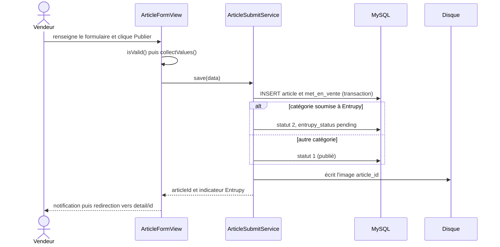

# Publier et promouvoir une annonce

[← Cas d'utilisation](../cas-d-utilisation.md)

Vues couvertes : `ArticleFormView` (`/ajouter-article`, `@PermitAll`), `DynamicArticleForm` (composant sans route), `FairePublicite` (`/publicite`, `@PermitAll`).

## UC-30 Publier une annonce

- **Acteur** : vendeur (tout utilisateur connecté, aucun contrôle de rôle). **Préconditions** : être authentifié et présent dans `personne` avec le même e-mail.

**Scénario nominal**
1. L'utilisateur ouvre « Ajouter un article ». La page affiche la navigation du compte et le formulaire `DynamicArticleForm`.
2. Il renseigne les champs communs : nom (obligatoire), description, prix (obligatoire, supérieur ou égal à 0), condition de paiement, mode de livraison, état, quantité (minimum 1) et une image (jpeg, png, gif ou webp, 1 Mo au plus).
3. Il choisit une catégorie (obligatoire) puis éventuellement une sous-catégorie. Les champs spécifiques apparaissent.
4. Il choisit vente à prix fixe ou **enchère**. Pour une enchère, il fixe une durée de 1 à 30 jours ; la date de début est l'instant courant et la date de fin est calculée. Le champ quantité est alors masqué.
5. Il clique sur « Publier ». La vue exécute `isValid()`, puis `collectValues()`, puis `submitService.save(data)`.
6. `ArticleSubmitService.save` crée l'article et la ligne `met_en_vente` dans une transaction, écrit l'image (`article_{id}{ext}`) après le commit, puis déplace la vidéo éventuelle.
7. Une notification de succès s'affiche (`artview.saved.ok`, ou `artview.saved.pending` si une authentification Entrupy est en attente) et l'utilisateur est redirigé vers `detail/{articleId}`.

**Champs spécifiques par catégorie**

| Catégorie | Champs |
|---|---|
| Toutes sauf Lingerie, Immobilier, Livres, DVD | fabricant |
| Voiture, Moto | chevaux, cylindrée, km, année, première mise en circulation, carburant, boîte, climatisation |
| Livres | auteur, éditeur (enregistré dans `marque`), année |
| Immobilier | location ou achat, pays, région (canton si Suisse, département si France), lieu, adresse, NPA, pièces, surface, terrain, année de construction |
| Vins | pays, région, cépage, millésime, type de vin |
| Jeux | type de jeu |
| DVD | acteurs, réalisateur, année, durée |
| Mode femme, homme, enfant, lingerie | taille |
| Sous-catégorie TV | type d'écran, dimension |
| Sous-catégories PC | processeur, RAM, disque dur |

**Règles métier**
- L'authentification Entrupy est requise pour les catégories 1, 2, 34 et 35 : l'article est créé au statut 2 (« en attente »), avec `entrupy_customer_item_id = CHIC-{id}` et `entrupy_status = pending`. Il passe au statut publié lors du webhook Entrupy. Pour les autres catégories il est créé au statut 1 (publié).
- La vidéo est demandée pour les catégories 1, 2 et 35.
- La vue n'appelle pas l'API Entrupy : elle positionne seulement l'état « en attente ».

**Alternatives et erreurs**
- Formulaire invalide (nom vide, catégorie absente, prix absent ou négatif) : erreurs sous les champs et notification `artview.fixErrors`.
- Échec de `save` : notification `artview.error` avec la cause racine, aucune redirection.
- Échec de l'écriture de l'image : l'article est supprimé (compensation) et l'exception est relancée.
- Échec du déplacement de la vidéo : `video_path` est remis à NULL, l'article reste publié.
- Bouton « Annuler » : retour à la racine sans confirmation.

**Postconditions** : article lié au vendeur et visible via sa fiche ; état « en attente » pour les catégories soumises à Entrupy.

**Remarques**
- Le panneau de capture vidéo par QR code est construit mais jamais ajouté à la page (`// TODO ADD IT add(videoPanel)`). Le dépôt d'une vidéo depuis un téléphone n'est donc pas utilisable dans l'interface.
- `isValid()` ne contrôle que le nom, la catégorie et le prix. Le fabricant, marqué obligatoire, n'est pas vérifié, ni aucun champ propre à une catégorie.
- En mode enchère, la date de fin peut rester nulle si aucune durée n'est choisie.
- La date de début affichée est figée à l'ouverture de la page, alors que `collectValues` recalcule l'instant au clic.
- Le pré-analyseur `PreAnalysisService` n'est pas appelé depuis ces vues.
- Les identifiants de catégories (1, 2, 34, 35) sont en dur dans le service.

## UC-31 Mettre une annonce en avant

- **Vue** : `FairePublicite` (`/publicite` ou `/publicite/{page}`, titre dynamique `publicite.pagetitle`).
- **Acteur** : vendeur connecté (principal OIDC).
- **Préconditions** : au moins un article actif sans publicité.

**Scénario nominal**
1. La vue charge l'e-mail de l'utilisateur, le total (`countActiveArticlesByVendeur`) et les 10 articles de la page (`findActiveArticlesByVendeurSansPub`).
2. La grille affiche nom, marque, prix de départ, meilleure offre (`findDerniereOffre`, une requête par ligne), date de fin d'enchère et un bouton « Pub ».
3. L'utilisateur clique sur « Pub ». Un dialogue (`publicite.dialog.titre`, texte `publicite.dialog.info`) demande confirmation.
4. Il confirme. `articleService.updateFaitDeLapublicite(idArticle)` est appelé, la notification `publicite.notif.activee` s'affiche et la grille est rafraîchie.

**Alternatives et erreurs**
- « Annuler » ferme le dialogue.
- Aucun `try/catch` : une erreur de service remonte au gestionnaire d'erreurs de Vaadin.
- Un principal non OIDC provoque une `ClassCastException`.

**Postcondition** : l'article n'apparaît plus dans la liste. L'effet exact de `updateFaitDeLapublicite` n'a pas été vérifié ; la liste d'accueil affiche un badge `main.promoted` pour les articles avec `pub = 1`.

**Remarques**
- Aucun paiement, montant, durée ou tarif n'est affiché dans cette vue. Le tarif de 1000 CHF n'apparaît que dans la page [Tarifs](01-acces-et-navigation.md) (UC-06).
- Les liens de pagination utilisent des chemins absolus `/{page}` au lieu de `/publicite/{page}` et mènent donc hors de la vue.
- Le total de pages n'est pas recalculé après une activation.
- Le propriétaire de l'article n'est pas revérifié au moment de l'activation.
- La vue contient du code mort (`buildArticlesTable`, `buildArticleRow`, `showSuccess`, `showError`), dont le message `publicite.empty` qui n'est jamais affiché.
