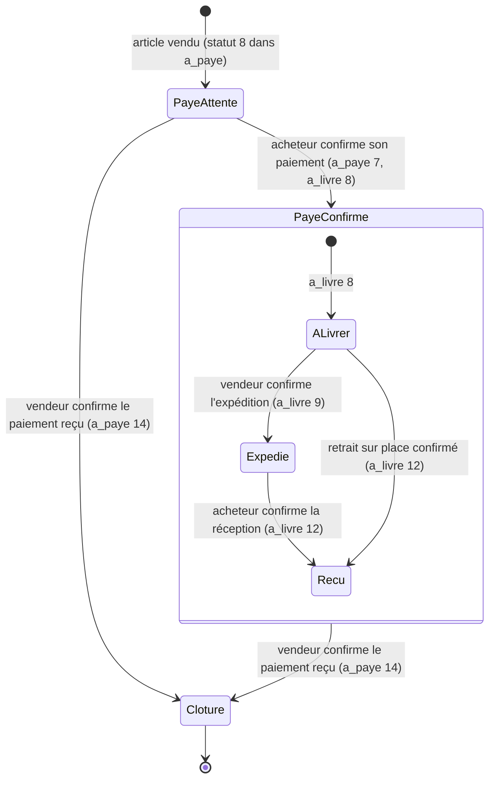

# Mon compte : paiements, livraisons et notes

[← Cas d'utilisation](../cas-d-utilisation.md)

Vues couvertes : `MonCompteView` (`/mon-compte`, `@PermitAll`, titre `account.page.title`) et `EncheresView` (`/encheres`).

`MonCompteView` est un hub de suivi des transactions. Il lit l'identité de l'utilisateur à partir du principal `OidcUser` (e-mail) et filtre toutes les listes par jointure sur `personne.email`. Il n'y a ni test de rôle ni redirection si la session est absente.

## Cycle de vie d'une transaction

Statuts observés dans `MonCompteView` et ses requêtes. Leur signification n'est pas documentée dans le code : ce schéma est la lecture la plus cohérente des transitions.

| Table | Statut | Sens déduit |
|---|---|---|
| `a_paye` | 8 | en attente de paiement (créé par l'achat direct ou la clôture d'enchère) |
| `a_paye` | 7 | l'acheteur a confirmé son paiement |
| `a_paye` | 14 | le vendeur a confirmé le paiement reçu (« Mes achats » et « Mes ventes ») |
| `a_livre` | 8 | à livrer ou à retirer |
| `a_livre` | 9 | expédié |
| `a_livre` | 12 | reçu |

Modes de livraison : 1 et 2 = poste, 3 = retrait sur place, 4 = domicile. Conditions de paiement : 5 = Twint, 3 = virement, les autres (comptant, PayPal, carte) sans traitement particulier.

## Navigation de la vue

Une barre secondaire propose cinq liens : informations, enchères, ajouter un article, publicité, calendrier. Un menu principal de treize options change le contenu sans recharger la page (`showContent`). Chaque liste est une grille de 80 lignes par page avec pagination en haut et en bas. Les colonnes communes sont l'identifiant, l'image, le nom (lien vers `/detail/{id}`), la marque, le prix et les actions.

| Option | Rôle | Liste |
|---|---|---|
| `myarticlepayes` | acheteur | articles à payer (`a_paye` statut 8) |
| `mywaitpayement` | vendeur | attentes de paiement (`a_paye` statut 7 ou 8) |
| `myobjectstodeliver` | vendeur | à livrer à domicile (`a_livre` statut 8, mode 4) |
| `myobjectstodeliverByPost` | vendeur | à livrer par la poste (`a_livre` statut 8, modes 1 et 2) |
| `mywaitdelivering` | acheteur | en attente de livraison à domicile (statut 9, mode 4) |
| `mywaitdeliveringbypost` | acheteur | en attente de livraison par la poste (statut 9, modes 1 et 2) |
| `myarticletopickup` | acheteur | à aller chercher (statut 8, mode 3) |
| `mywaitpickup` | vendeur | en attente de retrait par l'acheteur (statut 8, mode 3) |
| `myunsold` | vendeur | « Mes invendus » |
| `myselling` | vendeur | « Mes objets en vente » |
| `mybought` | acheteur | « Mes achats » (`a_paye` statut 14) |
| `mysold` | vendeur | « Mes ventes » (`a_paye` statut 14) |
| `statdealarticlebrand` | tous | statistiques par marque |

## UC-40 Confirmer mon paiement (acheteur)

- **Acteur** : acheteur. **Option** : `myarticlepayes`. **Préconditions** : une ligne `a_paye` au statut 8 dont il est l'acheteur.

**Scénario nominal**
1. L'acheteur clique sur `account.btn.confirm.payment`. La vue charge le vendeur et calcule le montant (prix, sinon dernière offre, sinon 0).
2. Le dialogue affiche l'article et la condition de paiement.
3. Selon la condition :
   - **Twint** : si le téléphone du vendeur est renseigné, il s'affiche avec un panneau montant, référence « Avant-Garde #{id} » et un QR-bill SVG généré par `QrBillService` ;
   - **Virement** : l'IBAN du vendeur s'affiche ;
   - **Autres conditions** : confirmation directe.
4. L'acheteur confirme. `articleService.updateStatutPaye` met `a_paye.ref_statut` à 7 et crée une ligne `a_livre` au statut 8 (sans doublon pour un même `ref_a_paye`).
5. Un e-mail « paiement réussi » part vers le vendeur, la liste est rechargée.

**Alternatives et erreurs**
- Vendeur introuvable : `account.notif.seller.not.found`, pas de dialogue.
- Condition de paiement absente : `account.notif.payment.undefined`, pas de dialogue.
- Twint sans téléphone : `account.notif.twint.missing` et e-mail au vendeur pour lui demander de compléter son compte.
- Virement sans IBAN : `account.notif.iban.missing` et même e-mail.
- Dans ces cas, le bouton de confirmation reste désactivé.
- Ligne `a_paye` absente : `IllegalStateException` non interceptée.

**Postconditions** : `a_paye` au statut 7, `a_livre` créée au statut 8, e-mail au vendeur.

## UC-41 Confirmer la réception du paiement (vendeur)

- **Acteur** : vendeur. **Option** : `mywaitpayement`. **Préconditions** : une ligne `a_paye` au statut 7 ou 8 dont il est le vendeur.

**Scénario nominal**
1. Le vendeur clique sur `account.btn.confirm.payment` (même libellé que pour l'acheteur). Le dialogue (`account.dlg.payment.received.title`) s'ouvre.
2. Il confirme. `articleService.insertAPaye` met à jour la ligne `a_paye` (acheteur, montant, date de fermeture, mode de livraison, condition de paiement, quantité 1, canton de l'acheteur) et fixe `ref_statut = 14`.
3. La liste est rechargée et un e-mail de paiement réussi est envoyé.

**Postconditions** : `a_paye` au statut 14, l'article apparaît dans « Mes achats » de l'acheteur et « Mes ventes » du vendeur.

**Remarques** : aucune notification de succès (le `Notification.show` est commenté). Malgré son nom, `insertAPaye` exécute un `UPDATE`. Le nom de la méthode de la vue, `showFaireOffreDialog`, est trompeur.

## UC-42 Confirmer l'expédition (vendeur)

- **Acteur** : vendeur. **Options** : `myobjectstodeliver` (domicile) et `myobjectstodeliverByPost` (poste). **Précondition** : `a_livre` au statut 8.

**Scénario nominal**
1. Le vendeur peut d'abord ouvrir le détail de l'acheteur (nom, adresse, pays) par `account.btn.buyer.profile`.
2. Il clique sur `account.btn.confirm.delivery`. La vue contrôle l'adresse de l'acheteur.
3. Il confirme. `updateStatutEstLivre` fait passer `a_livre` de 8 à 9 (condition SQL sur le statut 8).
4. La notification `account.notif.delivery.confirmed` s'affiche et la liste est rechargée.

**Alternatives et erreurs**
- Adresse de l'acheteur vide : e-mail à l'acheteur (`envoyerEmailAdresseManquante`) et notification `account.notif.address.missing`. L'état n'est pas modifié.
- Acheteur introuvable : `account.notif.error`.
- Livraison par la poste, mise à jour de 0 ligne : `account.notif.error`, le dialogue reste ouvert. Pour la livraison à domicile, le nombre de lignes modifiées n'est pas testé.

## UC-43 Confirmer la réception (acheteur)

- **Acteur** : acheteur. **Options** : `mywaitdelivering` (domicile) et `mywaitdeliveringbypost` (poste). **Précondition** : `a_livre` au statut 9.

**Scénario nominal**
1. L'acheteur clique sur le bouton de confirmation. Il peut consulter le profil du vendeur.
2. Domicile : `confirmerReception` met `a_livre.ref_statut` à 12 et `date_achat` à maintenant, sans condition sur le statut. Poste : `confirmerReceptionByPoste` fait passer 9 vers 12 avec `date_reception`, avec condition sur l'article, l'acheteur et le statut 9.
3. La notification `account.notif.reception.confirmed` s'affiche et la liste est rechargée.

**Alternatives** : mise à jour de 0 ligne pour la poste : `account.notif.error`, dialogue ouvert.

**Remarque** : le libellé du bouton de réception à domicile est celui de la livraison (`account.btn.confirm.delivery`).

## UC-44 Retrait sur place

- **Acteurs** : acheteur (option `myarticletopickup`) et vendeur (option `mywaitpickup`). **Précondition** : `a_livre` au statut 8, mode 3.

**Scénario nominal côté acheteur**
1. Il consulte les coordonnées du vendeur (nom, adresse, ville, pays).
2. Il confirme avoir retiré l'article (`account.btn.confirm.reception`) : `a_livre` passe à 12.

**Scénario nominal côté vendeur**
1. Il consulte les coordonnées de l'acheteur.
2. Il confirme la remise (`account.btn.confirm.pickup.reception`). `confirmerReceptionVendeur` fait passer `a_paye` à 14 et `a_livre` à 12.

**Remarque** : les deux confirmations sont indépendantes, sans ordre imposé.

## UC-45 Noter un achat

- **Acteur** : acheteur. **Option** : `mybought`. **Précondition** : une ligne `a_paye` au statut 14.

**Scénario nominal**
1. L'acheteur clique sur `account.btn.rate`.
2. Il choisit une note de 0 à 10 dans une liste.
3. Il confirme. `referenceService.enregistrerNote(idArticle, refAcheteur, note)` enregistre la note et `account.notif.rating.saved` s'affiche.

**Alternatives** : aucune note choisie : le dialogue se ferme sans message.

**Remarques** : aucun contrôle de note déjà donnée. Le comportement de `enregistrerNote` n'a pas été vérifié.

## UC-46 Suivre mes ventes, achats et articles

- **Acteur** : utilisateur connecté. **Options** : `myunsold`, `myselling`, `mybought`, `mysold`.
- **Scénario** : l'utilisateur choisit une option et consulte une liste paginée en lecture seule. Seules les listes d'achats offrent une action (UC-45).

**Remarques**
- `myunsold` et `myselling` utilisent la même grille et la même requête : leur contenu est identique. Le filtre de statut de la requête est commenté, un filtre `quantite > 0` le remplace.
- Plusieurs compteurs de pagination ne correspondent pas aux listes (voir [points d'attention](07-points-d-attention.md)).

## UC-47 Consulter les statistiques par marque

- **Acteur** : utilisateur connecté. **Option** : `statdealarticlebrand`.

**Scénario nominal**
1. L'utilisateur choisit une catégorie, une marque et une année (2020 à 2026, 2026 par défaut). La première catégorie et la première marque sont présélectionnées.
2. À chaque changement, `referenceService.findStatsByBrandAndYear` fournit les données.
3. Un histogramme de 12 barres (un par mois, libellés `account.month.1` à `12`) est dessiné.

**Remarques** : les statistiques ne sont pas filtrées par utilisateur. Le périmètre (ventes ou annonces) dépend de `ReferenceService`, non lu. Les années sont codées en dur.

## UC-48 Consulter mes articles actifs

- **Vue** : `EncheresView` (`/encheres` ou `/encheres/{page}`, titre `enc.page.title`).
- **Acteur** : utilisateur connecté.

**Scénario nominal**
1. La vue lit l'e-mail OIDC et charge 10 articles par page (`findActiveArticlesByVendeur`).
2. La grille affiche nom, marque, prix de départ, meilleure offre (`findDerniereOffre`), date de fin, quantité et statut (« vendu » si `quantite = 0`).
3. L'utilisateur navigue avec la pagination (fenêtre de ±2 pages) et peut trier les colonnes sur la page chargée.

**Remarques**
- Malgré le libellé de menu `account.nav.bids` (« enchères »), la liste concerne les articles mis en vente par l'utilisateur, non ses offres.
- Aucune action n'est possible sur une ligne : pas de lien vers la fiche, pas de bouton.
- Le statut se base sur `quantite = 0`, alors que les autres vues utilisent `vendu`.
- Une requête par ligne pour la meilleure offre (N+1).
