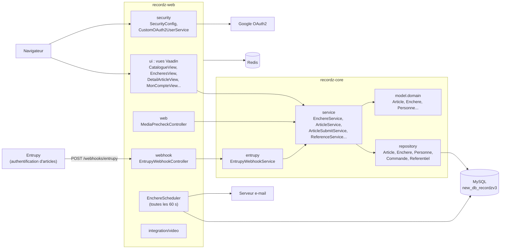
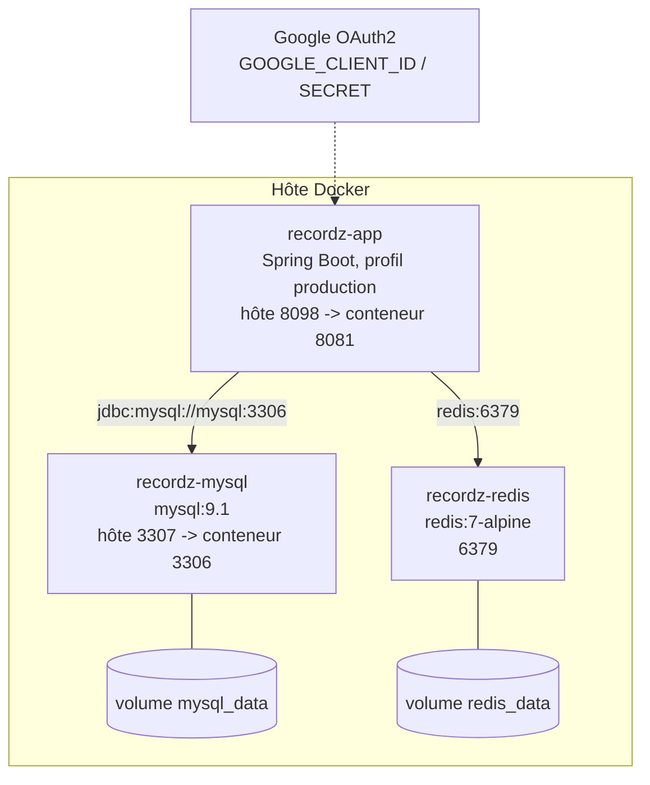
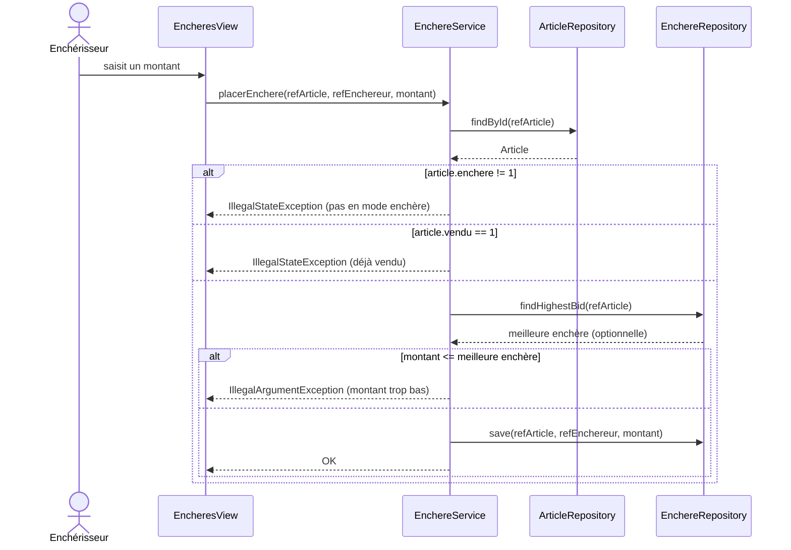
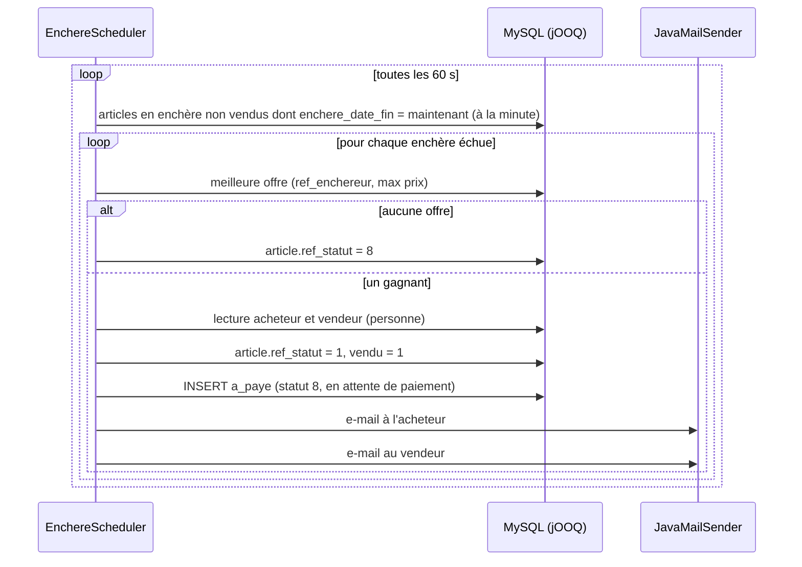

# Diagrammes d'architecture

Diagrammes Mermaid (rendus directement par GitHub) générés à partir du code source.
Pour l'analyse détaillée, voir [analyse-et-architecture.md](analyse-et-architecture.md) ;
pour les tables, voir [modele-de-donnees.md](modele-de-donnees.md).

## 1. Vue d'ensemble des composants

Maven multi-modules : `recordz-core` (domaine, services, accès aux données) et
`recordz-web` (interface Vaadin, sécurité, scheduler, webhooks). Java 21, Spring Boot 4.0.1,
Vaadin 25, jOOQ 3.20, MySQL 9.1.



> Le rôle exact de Redis (cache, sessions...) n'est pas déduit ici : seuls la configuration
> Docker et le package `model/domain/redis` le mentionnent.

## 2. Déploiement (docker-compose)



`app` démarre seulement quand les healthchecks de `mysql` et `redis` sont au vert
(`depends_on: condition: service_healthy`).

## 3. Séquence : placer une enchère

Règles appliquées par `EnchereService.placerEnchere`.



## 4. Séquence : clôture automatique des enchères

`EnchereScheduler.cloturerEncheresExpirees`, exécuté avec `@Scheduled(fixedDelay = 60_000)`.



## 5. Séquence : authentification Entrupy (webhook)

```mermaid
sequenceDiagram
    participant E as Entrupy
    participant C as EntrupyWebhookController
    participant W as EntrupyWebhookService
    participant A as ArticleAuthenticationService
    participant DB as MySQL

    E->>C: POST /webhooks/entrupy (en-tête Entrupy-Signature)
    C->>W: isSignatureValid(payload, signature) [HMAC-SHA256]
    alt signature invalide
        C-->>E: 401
    else signature valide
        C->>W: processEvent(payload)
        W->>W: aiguillage sur event
        Note over W: session.completed traité ; support.message et certificate.transfer journalisés seulement
        W->>A: updateAuthenticationStatus(customerItemId, entrupyId, certificateUrl, isAuthentic)
        A->>DB: UPDATE article (entrupy_status, entrupy_id, entrupy_certificate_url)
        opt article authentique
            A->>DB: UPDATE article SET ref_statut = 2
        end
        C-->>E: 200
    end
```

## Points d'attention observés dans le code

Ces remarques ne modifient rien : ce sont des constats à garder en tête en lisant les diagrammes.

- **Clôture à la minute exacte** : le scheduler compare `enchere_date_fin` avec l'heure courante
  formatée `yyyy-MM-dd HH:mm` (clause `LIKE`). Une enchère dont la minute de fin passe pendant
  un arrêt ou un redémarrage de l'application ne serait pas reprise au passage suivant.
- **Statuts numériques** : `article.ref_statut` utilise des valeurs en dur (1 = vendu aux enchères,
  8 = invendu, 2 = publié, avec un `TODO` à confirmer dans `ArticleAuthenticationService`).
  La valeur 8 désigne aussi « en attente de paiement » dans `a_paye`.
- **Packages** : `EnchereScheduler.java` déclare le package `com.example.recordz.scheduler` et
  `EntrupyWebhookController.java` le package `com.example.recordz.web.webhook`, alors que leurs
  fichiers sont rangés dans `recordz/` et `recordz/webhook/`.
- **Dockerfile** : `docker-compose.yml` référence un `Dockerfile` à la racine, absent de la liste
  des fichiers versionnés à la date de génération de ce document.
