# Modèle de données

Schéma `new_db_recordzv3`, généré à partir du script `dump_new_db_recordzv3.sql` (MySQL 9.1).

**68 tables, 111 clés étrangères déclarées.**

## Navigation

| Page | Contenu |
|---|---|
| [Utilisateurs, boutiques et dépôts](modele-de-donnees/01-utilisateurs.md) | 9 tables : Comptes (`personne`), boutiques, dépôts, relations entre visiteurs et comptes techniques. |
| [Articles, catalogue et suivi](modele-de-donnees/02-articles.md) | 11 tables : Annonces (`article`), mise en vente, commentaires, visites, demandes de visite et recherches. |
| [Enchères, commandes, paiements et évaluations](modele-de-donnees/03-encheres-commandes-paiements.md) | 12 tables : Offres, clôture (`a_paye`, `a_livre`), commandes, transactions, évaluations, modes de paiement et de livraison. |
| [Listes de souhaits](modele-de-donnees/04-wishlist.md) | 2 tables : Listes de souhaits des utilisateurs et leurs éléments. |
| [Référentiels (géographie, vin, état, véhicules, calendrier)](modele-de-donnees/05-referentiels.md) | 13 tables : Tables de valeurs utilisées par les articles et les utilisateurs. |
| [Libellés multilingues](modele-de-donnees/06-multilingue.md) | 21 tables : Schéma `libelle` / `langue` et tables `*_libelle_langue`. |
| [Dictionnaire des tables](modele-de-donnees/dictionnaire.md) | Colonnes, types, clés et références des 68 tables |

## Vue d'ensemble

Tables métier uniquement, sans colonnes. Les référentiels et les libellés multilingues sont décrits dans leurs pages. Ligne continue : clé étrangère déclarée ; ligne pointillée : référence logique sans contrainte en base.

```mermaid
erDiagram
    personne ||--o{ a_livre : "ref_acheteur"
    article ||--o{ a_livre : "ref_article"
    enchere |o--o{ a_livre : "ref_enchere"
    personne ||--o{ a_livre : "ref_vendeur"
    personne ||--o{ a_paye : "ref_acheteur"
    article ||--o{ a_paye : "ref_article"
    enchere |o--o{ a_paye : "ref_enchere"
    personne ||--o{ a_paye : "ref_vendeur"
    article ||--o| article_ip : "ref_article"
    article ||--o{ article_visite : "ref_article"
    personne ||--o{ article_visite : "ref_personne"
    personne ||--o{ boutique : "ref_personne"
    boutique ||--o{ boutique_a_categorie : "ref_boutique"
    categorie ||--o{ boutique_a_categorie : "ref_categorie"
    personne ||--o{ commande : "client_ref"
    personne ||--o{ commande : "ref_vendeur"
    article ||--o{ commande_article : "ref_article"
    commande ||--o{ commande_article : "ref_commande"
    article ||--o{ commentaire : "ref_article"
    personne ||--o{ commentaire : "ref_emetteur"
    article ||--o{ demande_visite : "ref_article"
    personne ||--o{ demande_visite : "ref_vendeur"
    personne ||--o{ depot : "ref_responsable"
    article ||--o{ enchere : "ref_article"
    personne ||--o{ enchere : "ref_enchereur"
    personne ||--o{ evaluation_achat : "ref_acheteur"
    article ||--o{ evaluation_achat : "ref_article"
    personne ||--o{ evaluation_achat : "ref_vendeur"
    personne ||--o{ evaluation_article : "ref_acheteur"
    article ||--o{ evaluation_article : "ref_article"
    personne ||--o{ evaluation_vente : "ref_acheteur"
    article ||--o{ evaluation_vente : "ref_article"
    personne ||--o{ evaluation_vente : "ref_vendeur"
    article ||--o{ met_en_vente : "ref_article"
    personne ||--o{ met_en_vente : "ref_vendeur"
    categorie ||--o{ recherche : "ref_categorie"
    personne ||--o{ visiteur : "ref_personne"
    personne ||--o{ visiteur : "ref_visiteur"
    categorie ||--o{ wish : "ref_categorie"
    wish_list ||--o{ wish : "ref_wish_list"
    personne ||--o{ wish : "ref_user"
    personne ||--o{ wish_list : "ref_user"
    a_paye ||..o{ a_livre : "ref_a_paye (sans FK)"
    categorie ||..o{ article : "ref_categorie (sans FK)"
    depot ||..o{ article : "ref_depot (sans FK)"
    personne ||..o{ evaluation_article : "ref_vendeur (sans FK)"
    personne ||..o{ transaction : "ref_acheteur (sans FK)"
    personne ||..o{ transaction : "ref_vendeur (sans FK)"
    article ||..o{ transaction : "ref_article (sans FK)"
    depot ||..o{ wish : "ref_depot (sans FK)"
```

## Observations sur le schéma

- **`transaction` n'a aucune clé étrangère** : `ref_acheteur`, `ref_vendeur` et `ref_article` pointent logiquement vers `personne` et `article`, sans contrainte.
- **Pas de table `statut`** : `article.ref_statut`, `commande.ref_statut`, `a_paye.ref_statut`, `a_livre.ref_statut` et `wish.ref_statut` désignent des statuts décrits seulement par `statut_libelle_langue` (sans clé étrangère vers une table de statuts). Les valeurs numériques utilisées par le code (1, 2, 8) ne sont donc pas contraintes en base.
- **Autres références sans table cible** : `ref_subcategorie`, `ref_taille`, `ref_couleur`, `ref_provenance`, `ref_location_ou_achat`, `ref_type_de_vin` (sur `article`) et `ref_main_categorie` (sur `boutique`) n'ont que leur table de libellés.
- **Sur `article`, seules 9 colonnes ont une clé étrangère** : `ref_boite_de_vitesse`, `ref_canton`, `ref_cepage`, `essence_ou_diesel`, `ref_etat`, `ref_mode_de_livraison`, `ref_pays_region_vin`, `ref_type_ecran`, `ref_type_de_jeux`. Les références vers `categorie`, `depot`, `pays`, `departement` et `condition_payement_ref` sont logiques.
- **Deux colonnes d'état sur `article`** : `etat` (entier, sans FK) et `ref_etat` (avec FK vers `etat`).
- **Tables sans aucune relation** (ni FK, ni référence logique détectée) : `app_user`, `pays_present`, `pointure`, `sessions`, `states`.
- Les colonnes `entrupy_*` et `video_path` sont bien présentes dans `article` : `entrupy_customer_item_id`, `entrupy_status`, `entrupy_id`, `entrupy_certificate_url`, `entrupy_updated_at`, `video_path`.

## Méthode

Les tables, colonnes, clés primaires et clés étrangères viennent directement du script SQL (instructions `CREATE TABLE`). Les références « logiques » sont déduites des noms de colonnes (`ref_categorie`, `ref_vendeur`...) et ne sont pas garanties par la base. Régénérer ce document après chaque évolution du schéma.
