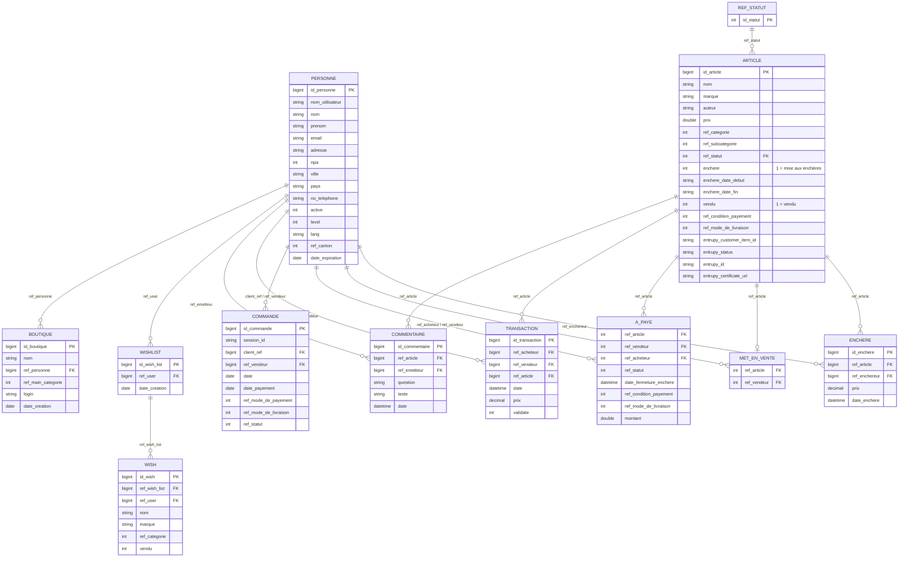
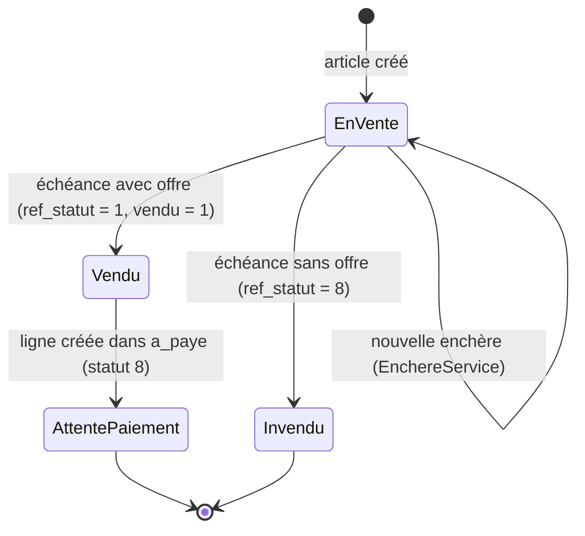

# Modèle de données

Diagramme entité-relation **déduit du code Java** (classes de `model/domain`) et des requêtes SQL
visibles dans les services et le scheduler. Il n'a pas été vérifié contre le script
`dump_new_db_recordzv3.sql` : les noms de colonnes en `snake_case` sont déduits des noms Java,
et les relations viennent des colonnes `ref_*`. Les clés étrangères réellement déclarées en base
peuvent différer.

Le diagramme ne liste que les colonnes structurantes. L'entité `Article` en porte beaucoup plus
(voir ci-dessous).

## Cycle de vie d'un article mis aux enchères

Déduit de `EnchereScheduler` et de `ArticleAuthenticationService`.

Pour les articles soumis à Entrupy, `ref_statut` passe à `2` (valeur à confirmer, voir le `TODO`
du code) quand le webhook `session.completed` annonce un résultat `authentic`.

## Spécificités de l'entité Article

`Article` est une classe unique qui regroupe les attributs de toutes les catégories. Seuls les
champs de la catégorie concernée sont renseignés.

| Catégorie | Champs propres |
|---|---|
| Véhicules | `nb_km`, `premiere_immatriculation`, `nb_cheveaux`, `nb_cylindre`, `essence_ou_diesel`, `ref_boite_de_vitesse`, `clima`, `nb_porte` |
| Immobilier | `nb_piece`, `surface_habitable`, `superficie_terrain`, `annee_construction`, `ref_location_ou_achat` |
| Vins | `ref_cepage`, `ref_type_de_vin`, `ref_pays_region_vin`, millésime (stocké dans `tx`) |
| DVD | `acteurs`, `realisateur`, durée (stockée dans `presound`) |
| Informatique | `processeur`, `ram`, `disque_dur` |
| TV | `ref_type_ecran`, `dimension` |
| Vêtements | `ref_taille`, `taille`, `ref_couleur` |
| Jeux | `ref_type_de_jeux` |
| Authentification | `entrupy_status`, `entrupy_id`, `entrupy_certificate_url`, `entrupy_customer_item_id`, `entrupy_updated_at` |

Les catégories (`ref_categorie`) sont aussi décrites par l'énumération `ArticleCategory`
(Mode, Montres, Bijoux, Voiture, Vins, Immobilier, etc.) et les sous-catégories par
`ArticleSubCategory`.

> Plusieurs colonnes sont réutilisées pour des usages différents selon la catégorie
> (`tx` pour le millésime, `presound` pour la durée d'un DVD) : à garder en tête avant de
> modifier le schéma.
