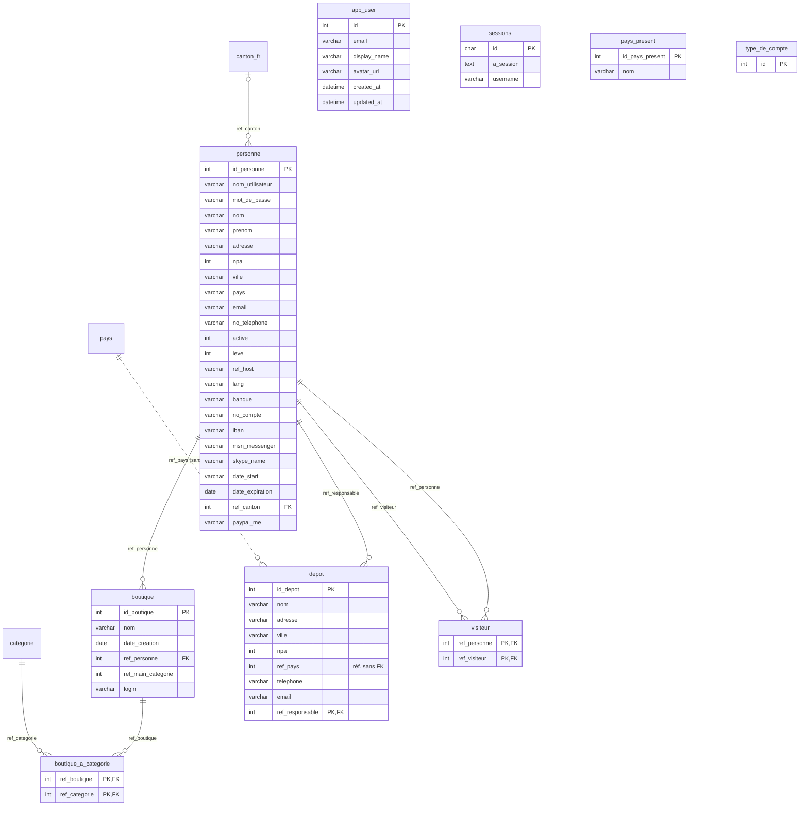

# Utilisateurs, boutiques et dépôts

[← Modèle de données](../modele-de-donnees.md) · [Dictionnaire](dictionnaire.md)

Comptes (`personne`), boutiques, dépôts, relations entre visiteurs et comptes techniques.

Ligne continue : clé étrangère déclarée. Ligne pointillée : référence logique sans contrainte en base. Les tables sans colonnes dans le diagramme appartiennent à un autre domaine.

## Tables de ce domaine

| Table | Colonnes | Lignes (dump) | Références sortantes |
|---|---:|---:|---|
| [app_user](dictionnaire.md#app_user) | 6 | 0 | - |
| [boutique](dictionnaire.md#boutique) | 6 | 0 | personne |
| [boutique_a_categorie](dictionnaire.md#boutique_a_categorie) | 2 | 0 | boutique, categorie |
| [depot](dictionnaire.md#depot) | 9 | 0 | personne |
| [pays_present](dictionnaire.md#pays_present) | 2 | 2 | - |
| [personne](dictionnaire.md#personne) | 24 | 4 | canton_fr |
| [sessions](dictionnaire.md#sessions) | 3 | 0 | - |
| [type_de_compte](dictionnaire.md#type_de_compte) | 1 | 0 | - |
| [visiteur](dictionnaire.md#visiteur) | 2 | 0 | personne |
