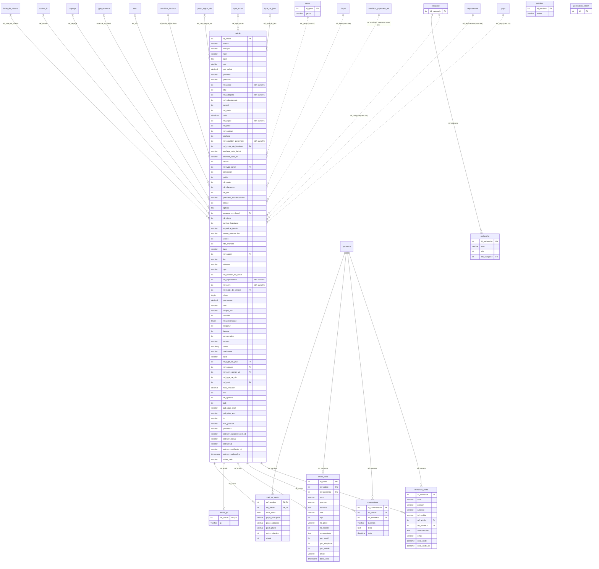

# Articles, catalogue et suivi

[← Modèle de données](../modele-de-donnees.md) · [Dictionnaire](dictionnaire.md)

Annonces (`article`), mise en vente, commentaires, visites, demandes de visite et recherches.

Ligne continue : clé étrangère déclarée. Ligne pointillée : référence logique sans contrainte en base. Les tables sans colonnes dans le diagramme appartiennent à un autre domaine.

## Tables de ce domaine

| Table | Colonnes | Lignes (dump) | Références sortantes |
|---|---:|---:|---|
| [article](dictionnaire.md#article) | 83 | 7 | boite_de_vitesse, canton_fr, cepage, condition_livraison, etat, pays_region_vin, type_de_jeux, type_ecran, type_essence |
| [article_ip](dictionnaire.md#article_ip) | 2 | 0 | article |
| [article_visite](dictionnaire.md#article_visite) | 16 | 272 | article, personne |
| [categorie](dictionnaire.md#categorie) | 1 | 45 | - |
| [commentaire](dictionnaire.md#commentaire) | 6 | 3 | article, personne |
| [demande_visite](dictionnaire.md#demande_visite) | 11 | 10 | article, personne |
| [genre](dictionnaire.md#genre) | 2 | 0 | - |
| [met_en_vente](dictionnaire.md#met_en_vente) | 8 | 7 | article, personne |
| [pointure](dictionnaire.md#pointure) | 2 | 0 | - |
| [publication_option](dictionnaire.md#publication_option) | 1 | 0 | - |
| [recherche](dictionnaire.md#recherche) | 4 | 0 | categorie |
