# Enchères, commandes, paiements et évaluations

[← Modèle de données](../modele-de-donnees.md) · [Dictionnaire](dictionnaire.md)

Offres, clôture (`a_paye`, `a_livre`), commandes, transactions, évaluations, modes de paiement et de livraison.

```mermaid
erDiagram
    article ||--o{ enchere : "ref_article"
    personne ||--o{ enchere : "ref_enchereur"
    personne ||--o{ a_paye : "ref_acheteur"
    article ||--o{ a_paye : "ref_article"
    canton_fr |o--o{ a_paye : "ref_canton"
    enchere |o--o{ a_paye : "ref_enchere"
    condition_livraison ||--o{ a_paye : "ref_mode_de_livraison"
    personne ||--o{ a_paye : "ref_vendeur"
    personne ||--o{ a_livre : "ref_acheteur"
    article ||--o{ a_livre : "ref_article"
    enchere |o--o{ a_livre : "ref_enchere"
    condition_livraison |o--o{ a_livre : "ref_mode_de_livraison"
    personne ||--o{ a_livre : "ref_vendeur"
    personne ||--o{ commande : "client_ref"
    condition_livraison ||--o{ commande : "ref_mode_de_livraison"
    mode_de_payement ||--o{ commande : "ref_mode_de_payement"
    personne ||--o{ commande : "ref_vendeur"
    article ||--o{ commande_article : "ref_article"
    commande ||--o{ commande_article : "ref_commande"
    personne ||--o{ evaluation_achat : "ref_acheteur"
    article ||--o{ evaluation_achat : "ref_article"
    personne ||--o{ evaluation_achat : "ref_vendeur"
    personne ||--o{ evaluation_vente : "ref_acheteur"
    article ||--o{ evaluation_vente : "ref_article"
    personne ||--o{ evaluation_vente : "ref_vendeur"
    personne ||--o{ evaluation_article : "ref_acheteur"
    article ||--o{ evaluation_article : "ref_article"
    a_paye ||..o{ a_livre : "ref_a_paye (sans FK)"
    condition_payement_ref ||..o{ a_paye : "ref_condition_payement (sans FK)"
    personne ||..o{ evaluation_article : "ref_vendeur (sans FK)"
    personne ||..o{ transaction : "ref_acheteur (sans FK)"
    personne ||..o{ transaction : "ref_vendeur (sans FK)"
    article ||..o{ transaction : "ref_article (sans FK)"
    enchere {
        int id_enchere PK
        int ref_article FK
        int ref_enchereur FK
        decimal prix
        datetime date_enchere
    }
    a_paye {
        int id_a_paye PK
        int ref_article FK
        int ref_vendeur FK
        int ref_acheteur FK
        int ref_enchere FK
        int ref_condition_payement "réf. sans FK"
        int ref_mode_de_livraison FK
        int ref_statut
        decimal montant
        datetime date_fermeture_enchere
        datetime date_payement
        datetime date_echeance
        date rappel_1
        date rappel_2
        date rappel_3
        int quantite
        int ref_canton FK
    }
    a_livre {
        int id_a_livre PK
        int ref_article FK
        int ref_acheteur FK
        int ref_vendeur FK
        int ref_enchere FK
        datetime date_achat
        int ref_mode_de_livraison FK
        int ref_statut
        int quantite
        varchar montant
        date date_reception
        int ref_a_paye "réf. sans FK"
    }
    commande {
        int id_commande PK
        char session_id
        int client_ref FK
        date date
        int ref_mode_de_payement FK
        date date_payement
        int ref_vendeur FK
        int ref_statut
        int ref_mode_de_livraison FK
    }
    commande_article {
        int ref_commande PK, FK
        int ref_article PK, FK
        date date_payement PK
    }
    transaction {
        int id_transaction PK
        int ref_acheteur "réf. sans FK"
        int ref_vendeur "réf. sans FK"
        datetime date
        decimal prix
        int validate
        int ref_article "réf. sans FK"
    }
    evaluation_achat {
        int id_evaluation_achat PK
        int ref_vendeur FK
        int ref_acheteur FK
        int ref_article FK
        tinyint note
        text commentaire
        datetime date
    }
    evaluation_vente {
        int id_evaluation_vente PK
        int ref_vendeur FK
        int ref_acheteur FK
        int ref_article FK
        tinyint note
        text commentaire
        datetime date
    }
    evaluation_article {
        int id_evaluation_article PK
        int ref_article FK
        int ref_vendeur "réf. sans FK"
        int ref_acheteur FK
        int note
        datetime date
    }
    mode_de_payement {
        int id PK
    }
    condition_livraison {
        int id PK
    }
    condition_payement_ref {
        int ref_condition_payement PK
    }
```

Ligne continue : clé étrangère déclarée. Ligne pointillée : référence logique sans contrainte en base. Les tables sans colonnes dans le diagramme appartiennent à un autre domaine.

## Tables de ce domaine

| Table | Colonnes | Lignes (dump) | Références sortantes |
|---|---:|---:|---|
| [a_livre](dictionnaire.md#a_livre) | 12 | 53 | article, condition_livraison, enchere, personne |
| [a_paye](dictionnaire.md#a_paye) | 17 | 60 | article, canton_fr, condition_livraison, enchere, personne |
| [commande](dictionnaire.md#commande) | 9 | 0 | condition_livraison, mode_de_payement, personne |
| [commande_article](dictionnaire.md#commande_article) | 3 | 0 | article, commande |
| [condition_livraison](dictionnaire.md#condition_livraison) | 1 | 4 | - |
| [condition_payement_ref](dictionnaire.md#condition_payement_ref) | 1 | 5 | - |
| [enchere](dictionnaire.md#enchere) | 5 | 2 | article, personne |
| [evaluation_achat](dictionnaire.md#evaluation_achat) | 7 | 0 | article, personne |
| [evaluation_article](dictionnaire.md#evaluation_article) | 6 | 0 | article, personne |
| [evaluation_vente](dictionnaire.md#evaluation_vente) | 7 | 0 | article, personne |
| [mode_de_payement](dictionnaire.md#mode_de_payement) | 1 | 0 | - |
| [transaction](dictionnaire.md#transaction) | 7 | 17 | - |
