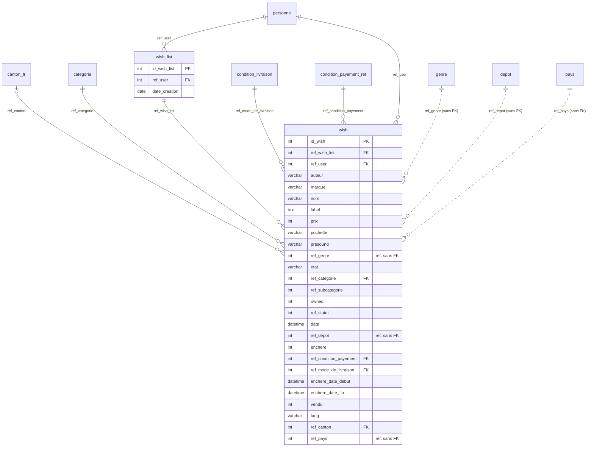

# Listes de souhaits

[← Modèle de données](../modele-de-donnees.md) · [Dictionnaire](dictionnaire.md)

Listes de souhaits des utilisateurs et leurs éléments.

Ligne continue : clé étrangère déclarée. Ligne pointillée : référence logique sans contrainte en base. Les tables sans colonnes dans le diagramme appartiennent à un autre domaine.

## Tables de ce domaine

| Table | Colonnes | Lignes (dump) | Références sortantes |
|---|---:|---:|---|
| [wish](dictionnaire.md#wish) | 27 | 0 | canton_fr, categorie, condition_livraison, condition_payement_ref, personne, wish_list |
| [wish_list](dictionnaire.md#wish_list) | 3 | 0 | personne |
