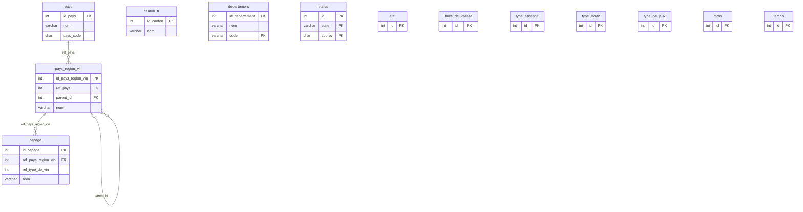

# Référentiels (géographie, vin, état, véhicules, calendrier)

[← Modèle de données](../modele-de-donnees.md) · [Dictionnaire](dictionnaire.md)

Tables de valeurs utilisées par les articles et les utilisateurs.

Ligne continue : clé étrangère déclarée. Ligne pointillée : référence logique sans contrainte en base. Les tables sans colonnes dans le diagramme appartiennent à un autre domaine.

## Tables de ce domaine

| Table | Colonnes | Lignes (dump) | Références sortantes |
|---|---:|---:|---|
| [boite_de_vitesse](dictionnaire.md#boite_de_vitesse) | 1 | 3 | - |
| [canton_fr](dictionnaire.md#canton_fr) | 2 | 26 | - |
| [cepage](dictionnaire.md#cepage) | 4 | 541 | pays_region_vin |
| [departement](dictionnaire.md#departement) | 3 | 0 | - |
| [etat](dictionnaire.md#etat) | 1 | 2 | - |
| [mois](dictionnaire.md#mois) | 1 | 12 | - |
| [pays](dictionnaire.md#pays) | 3 | 0 | - |
| [pays_region_vin](dictionnaire.md#pays_region_vin) | 4 | 2 | pays, pays_region_vin |
| [states](dictionnaire.md#states) | 3 | 0 | - |
| [temps](dictionnaire.md#temps) | 1 | 0 | - |
| [type_de_jeux](dictionnaire.md#type_de_jeux) | 1 | 3 | - |
| [type_ecran](dictionnaire.md#type_ecran) | 1 | 2 | - |
| [type_essence](dictionnaire.md#type_essence) | 1 | 3 | - |
