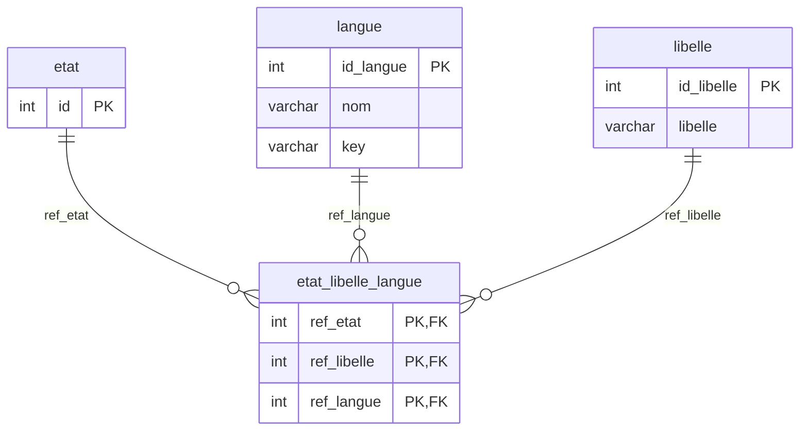

# Libellés multilingues

[← Modèle de données](../modele-de-donnees.md) · [Dictionnaire](dictionnaire.md)

Schéma `libelle` / `langue` et tables `*_libelle_langue`.

## Principe

Chaque référentiel traduit (`etat`, `categorie`, `condition_livraison`...) possède une table `*_libelle_langue` qui associe une valeur du référentiel, une langue et un libellé. Le diagramme montre le schéma avec `etat` comme exemple ; les autres tables suivent le même modèle (liste ci-dessous).

## Tables de libellés

| Table de libellés | Référentiel | FK vers le référentiel | Lignes (dump) |
|---|---|:---:|---:|
| [boite_de_vitesse_libelle_langue](dictionnaire.md#boite_de_vitesse_libelle_langue) | [boite_de_vitesse](dictionnaire.md#boite_de_vitesse) | oui | 6 |
| [categorie_libelle_langue](dictionnaire.md#categorie_libelle_langue) | [categorie](dictionnaire.md#categorie) | oui | 124 |
| [condition_livraison_libelle_langue](dictionnaire.md#condition_livraison_libelle_langue) | [condition_livraison](dictionnaire.md#condition_livraison) | oui | 12 |
| [condition_payement_libelle_langue](dictionnaire.md#condition_payement_libelle_langue) | `condition_payement` (pas de table) | non | 15 |
| [etat_libelle_langue](dictionnaire.md#etat_libelle_langue) | [etat](dictionnaire.md#etat) | oui | 6 |
| [location_ou_achat_libelle_langue](dictionnaire.md#location_ou_achat_libelle_langue) | `location_ou_achat` (pas de table) | non | 6 |
| [main_categorie_libelle_langue](dictionnaire.md#main_categorie_libelle_langue) | `main_categorie` (pas de table) | non | 0 |
| [mode_de_payement_libelle_langue](dictionnaire.md#mode_de_payement_libelle_langue) | [mode_de_payement](dictionnaire.md#mode_de_payement) | oui | 0 |
| [mois_libelle_langue](dictionnaire.md#mois_libelle_langue) | [mois](dictionnaire.md#mois) | oui | 12 |
| [publication_option_libelle_langue](dictionnaire.md#publication_option_libelle_langue) | [publication_option](dictionnaire.md#publication_option) | oui | 0 |
| [statut_libelle_langue](dictionnaire.md#statut_libelle_langue) | `statut` (pas de table) | non | 0 |
| [subcategorie_libelle_langue](dictionnaire.md#subcategorie_libelle_langue) | `subcategorie` (pas de table) | non | 1465 |
| [taille_libelle_langue](dictionnaire.md#taille_libelle_langue) | `taille` (pas de table) | non | 0 |
| [temps_libelle_langue](dictionnaire.md#temps_libelle_langue) | [temps](dictionnaire.md#temps) | oui | 0 |
| [type_de_compte_libelle_langue](dictionnaire.md#type_de_compte_libelle_langue) | [type_de_compte](dictionnaire.md#type_de_compte) | oui | 0 |
| [type_de_jeux_libelle_langue](dictionnaire.md#type_de_jeux_libelle_langue) | [type_de_jeux](dictionnaire.md#type_de_jeux) | oui | 9 |
| [type_de_vin_libelle_langue](dictionnaire.md#type_de_vin_libelle_langue) | `type_de_vin` (pas de table) | non | 12 |
| [type_ecran_libelle_langue](dictionnaire.md#type_ecran_libelle_langue) | [type_ecran](dictionnaire.md#type_ecran) | oui | 6 |
| [type_essence_libelle_langue](dictionnaire.md#type_essence_libelle_langue) | [type_essence](dictionnaire.md#type_essence) | oui | 9 |

## Tables de ce domaine

| Table | Colonnes | Lignes (dump) | Références sortantes |
|---|---:|---:|---|
| [boite_de_vitesse_libelle_langue](dictionnaire.md#boite_de_vitesse_libelle_langue) | 3 | 6 | boite_de_vitesse, langue, libelle |
| [categorie_libelle_langue](dictionnaire.md#categorie_libelle_langue) | 3 | 124 | categorie, langue |
| [condition_livraison_libelle_langue](dictionnaire.md#condition_livraison_libelle_langue) | 4 | 12 | condition_livraison, langue, libelle |
| [condition_payement_libelle_langue](dictionnaire.md#condition_payement_libelle_langue) | 3 | 15 | - |
| [etat_libelle_langue](dictionnaire.md#etat_libelle_langue) | 3 | 6 | etat, langue, libelle |
| [langue](dictionnaire.md#langue) | 3 | 3 | - |
| [libelle](dictionnaire.md#libelle) | 2 | 1409 | - |
| [location_ou_achat_libelle_langue](dictionnaire.md#location_ou_achat_libelle_langue) | 3 | 6 | langue, libelle |
| [main_categorie_libelle_langue](dictionnaire.md#main_categorie_libelle_langue) | 3 | 0 | langue, libelle |
| [mode_de_payement_libelle_langue](dictionnaire.md#mode_de_payement_libelle_langue) | 3 | 0 | langue, libelle, mode_de_payement |
| [mois_libelle_langue](dictionnaire.md#mois_libelle_langue) | 3 | 12 | langue, libelle, mois |
| [publication_option_libelle_langue](dictionnaire.md#publication_option_libelle_langue) | 4 | 0 | langue, libelle, publication_option |
| [statut_libelle_langue](dictionnaire.md#statut_libelle_langue) | 3 | 0 | langue, libelle |
| [subcategorie_libelle_langue](dictionnaire.md#subcategorie_libelle_langue) | 4 | 1465 | categorie, langue, libelle |
| [taille_libelle_langue](dictionnaire.md#taille_libelle_langue) | 4 | 0 | langue, libelle |
| [temps_libelle_langue](dictionnaire.md#temps_libelle_langue) | 3 | 0 | langue, libelle, temps |
| [type_de_compte_libelle_langue](dictionnaire.md#type_de_compte_libelle_langue) | 4 | 0 | langue, libelle, type_de_compte |
| [type_de_jeux_libelle_langue](dictionnaire.md#type_de_jeux_libelle_langue) | 3 | 9 | langue, libelle, type_de_jeux |
| [type_de_vin_libelle_langue](dictionnaire.md#type_de_vin_libelle_langue) | 3 | 12 | langue, libelle |
| [type_ecran_libelle_langue](dictionnaire.md#type_ecran_libelle_langue) | 3 | 6 | langue, libelle, type_ecran |
| [type_essence_libelle_langue](dictionnaire.md#type_essence_libelle_langue) | 3 | 9 | langue, libelle, type_essence |
