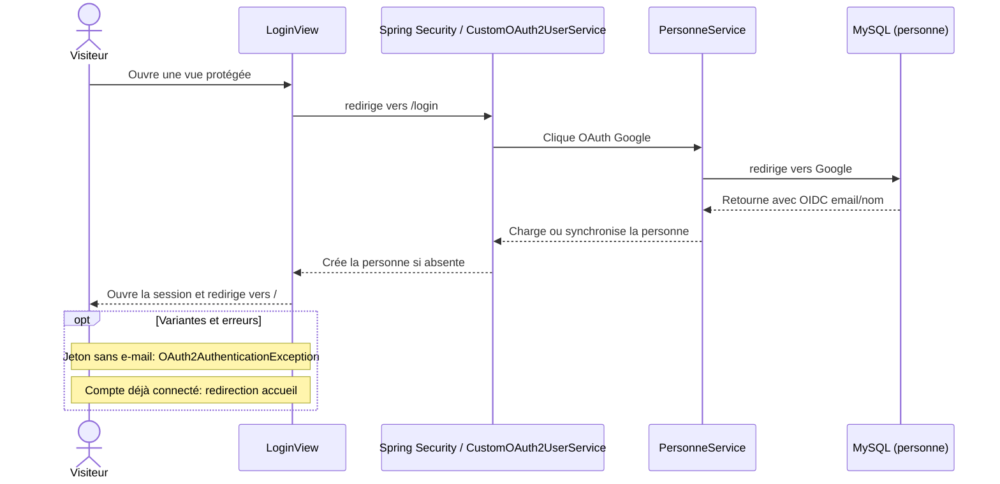
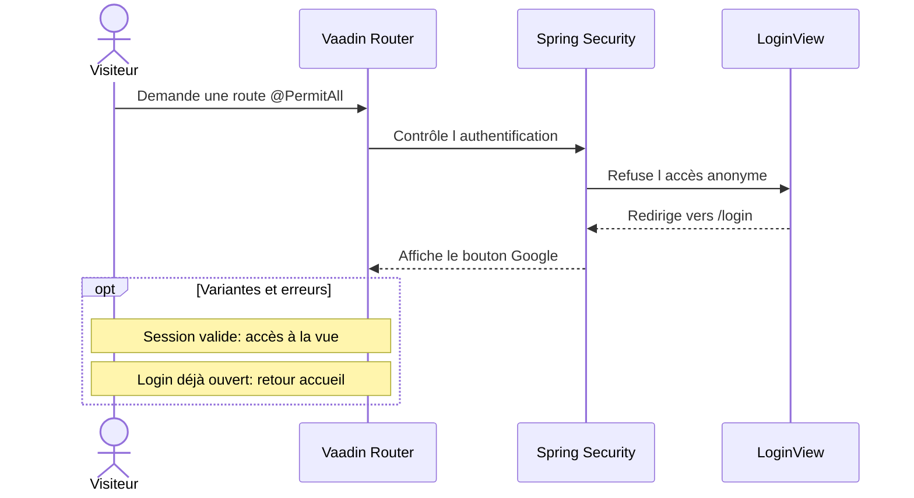
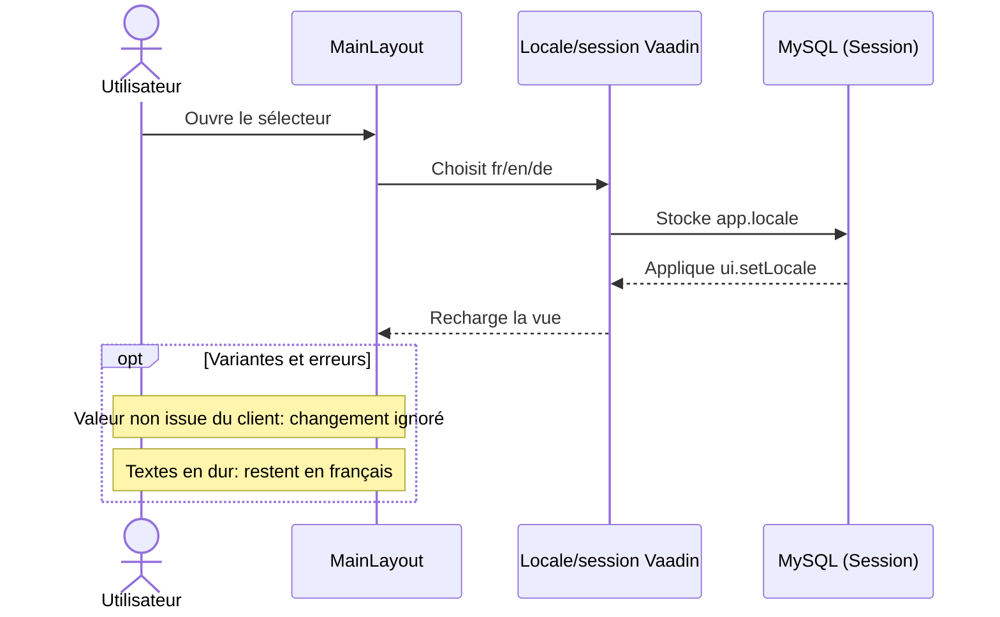
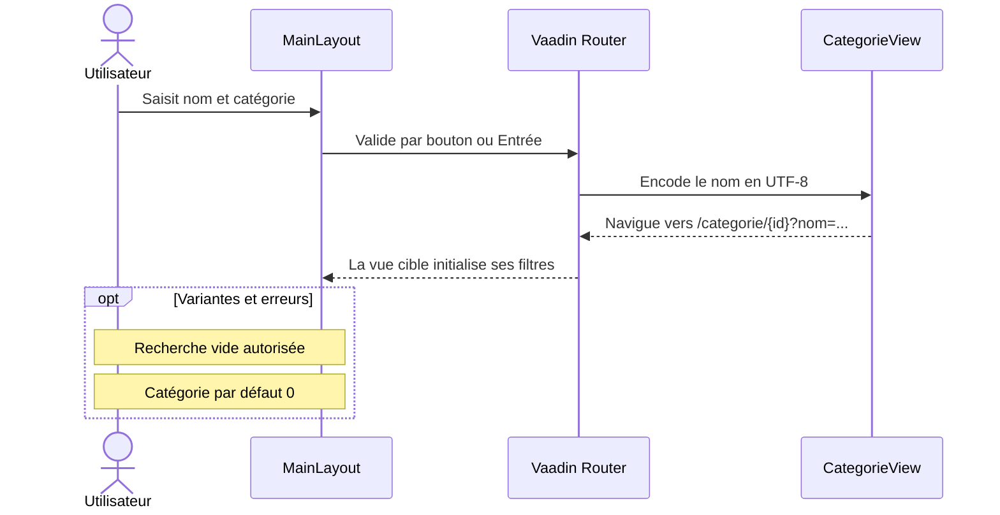
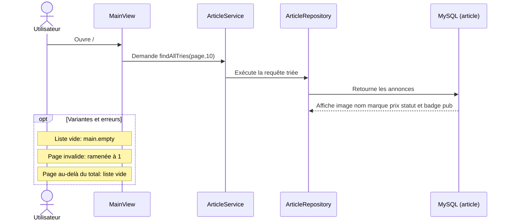
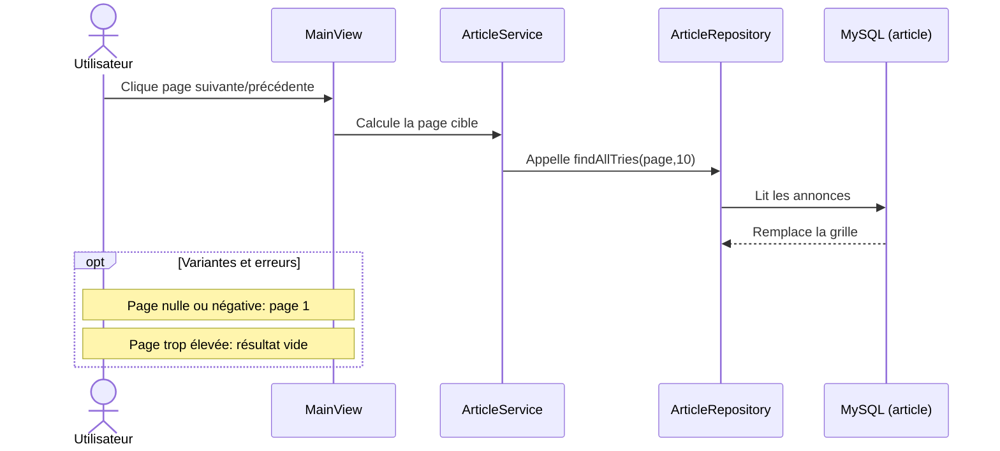
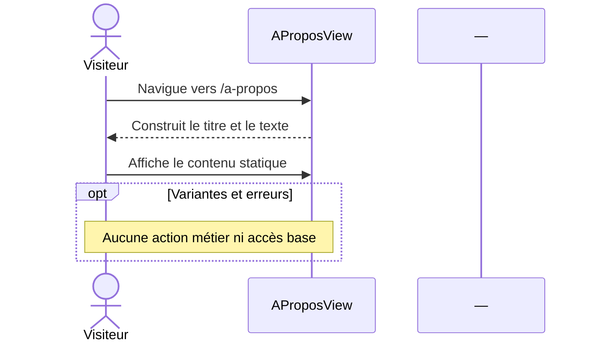

# 01 Acces Navigation

[← Index des diagrammes](./README.md)

## D01 — Connexion Google et création/actualisation du compte

**Résultat attendu :** connexion google et création/actualisation du compte selon le scénario décrit.

## D02 — Redirection vers login depuis une vue protégée

**Résultat attendu :** redirection vers login depuis une vue protégée selon le scénario décrit.

## D03 — Changer la langue de l interface

**Résultat attendu :** changer la langue de l interface selon le scénario décrit.

## D04 — Recherche depuis la barre de navigation

**Résultat attendu :** recherche depuis la barre de navigation selon le scénario décrit.

## D05 — Afficher la page d accueil et ses annonces

**Résultat attendu :** afficher la page d accueil et ses annonces selon le scénario décrit.

## D06 — Paginer les annonces de l accueil

**Résultat attendu :** paginer les annonces de l accueil selon le scénario décrit.

## D07 — Consulter À propos

**Résultat attendu :** consulter à propos selon le scénario décrit.
