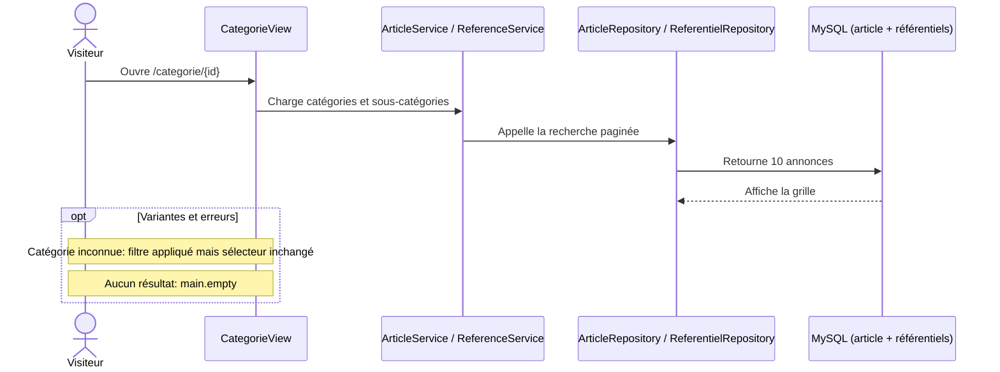
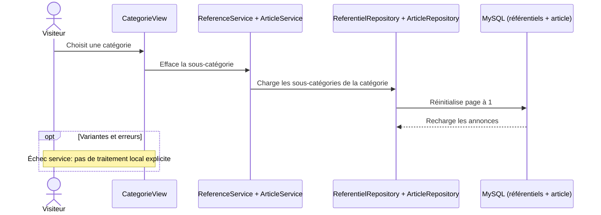
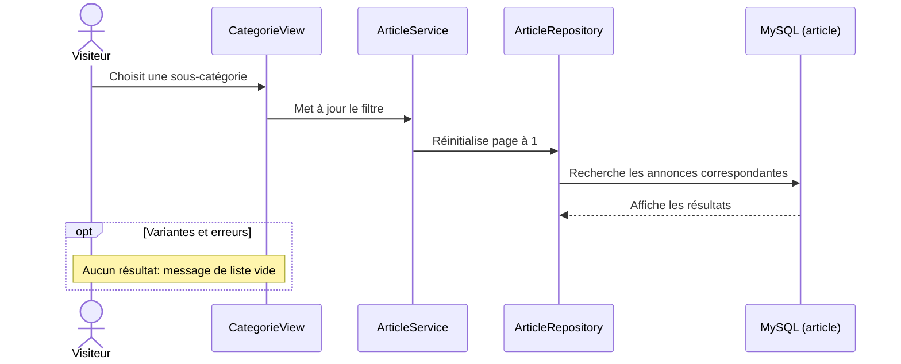
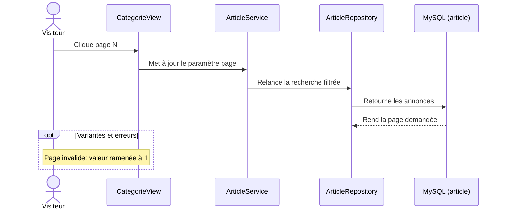
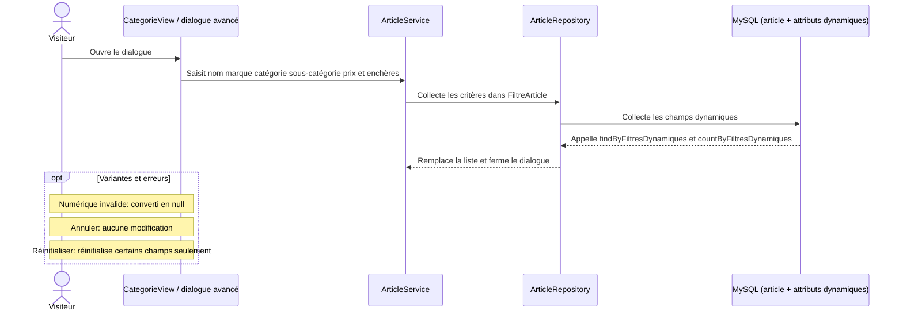
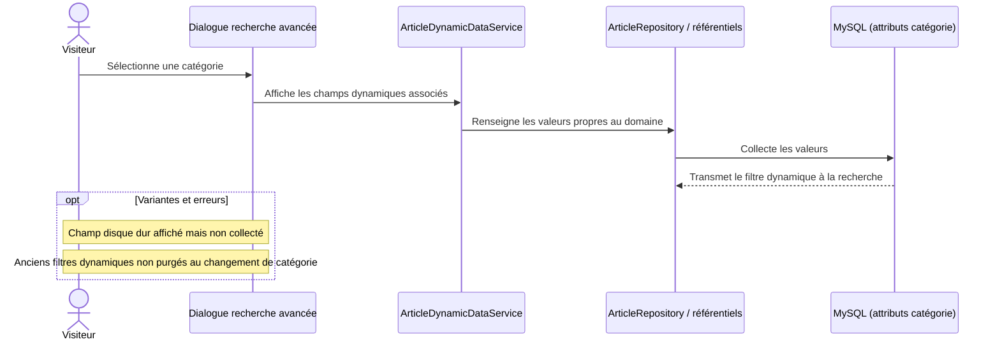

# 02 Catalogue Recherche

[← Index des diagrammes](./README.md)

## D08 — Parcourir les annonces par catégorie

**Résultat attendu :** parcourir les annonces par catégorie selon le scénario décrit.

## D09 — Changer la catégorie et réinitialiser la sous-catégorie

**Résultat attendu :** changer la catégorie et réinitialiser la sous-catégorie selon le scénario décrit.

## D10 — Filtrer par sous-catégorie

**Résultat attendu :** filtrer par sous-catégorie selon le scénario décrit.

## D11 — Paginer les résultats par catégorie

**Résultat attendu :** paginer les résultats par catégorie selon le scénario décrit.

## D12 — Recherche avancée multicritère

**Résultat attendu :** recherche avancée multicritère selon le scénario décrit.

## D13 — Recherche avancée avec attributs spécifiques de catégorie

**Résultat attendu :** recherche avancée avec attributs spécifiques de catégorie selon le scénario décrit.
