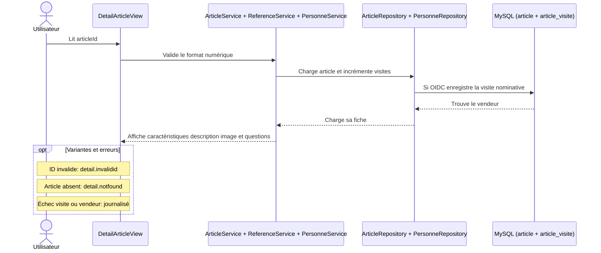
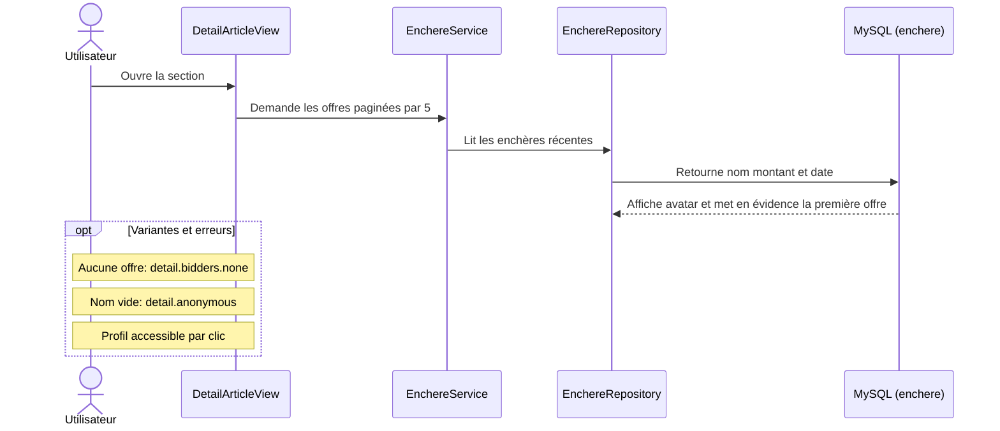
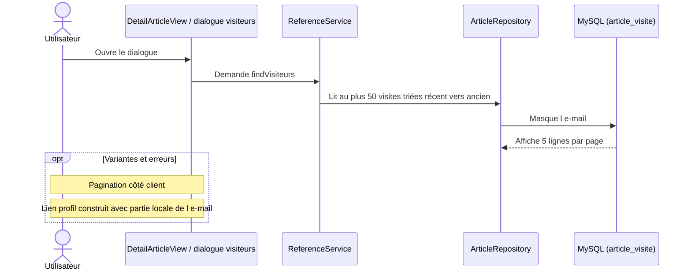
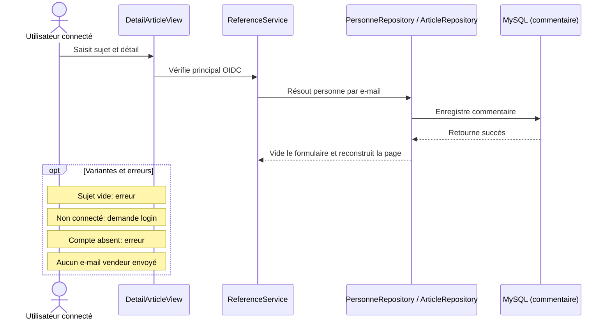
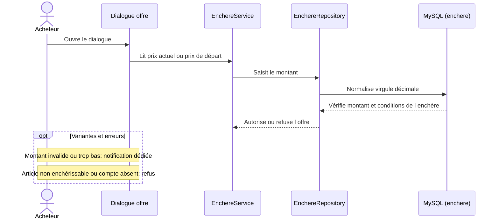
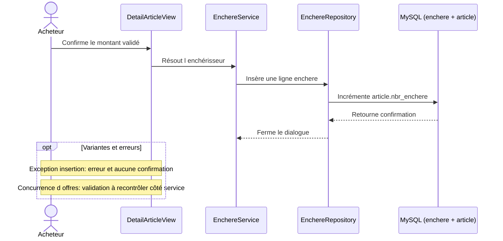
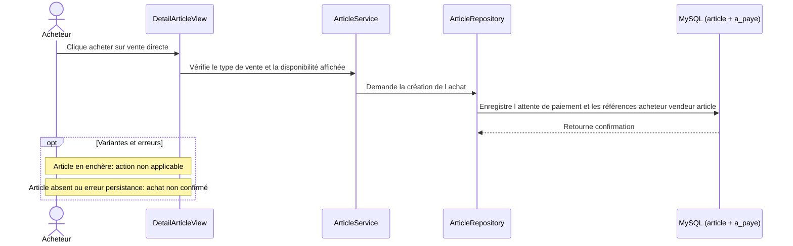

# 03 Fiche Article Offres

[← Index des diagrammes](./README.md)

## D14 — Consulter une fiche article et enregistrer la visite

**Résultat attendu :** consulter une fiche article et enregistrer la visite selon le scénario décrit.

## D15 — Afficher les derniers enchérisseurs

**Résultat attendu :** afficher les derniers enchérisseurs selon le scénario décrit.

## D16 — Consulter les visiteurs d un article

**Résultat attendu :** consulter les visiteurs d un article selon le scénario décrit.

## D17 — Poser une question sur un article

**Résultat attendu :** poser une question sur un article selon le scénario décrit.

## D18 — Valider les règles d une offre

**Résultat attendu :** valider les règles d une offre selon le scénario décrit.

## D19 — Enregistrer une offre valide

**Résultat attendu :** enregistrer une offre valide selon le scénario décrit.

## D20 — Acheter directement un article

**Résultat attendu :** acheter directement un article selon le scénario décrit.
