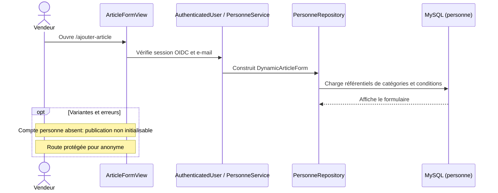
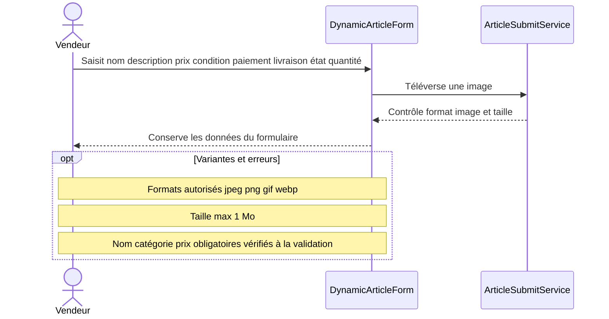
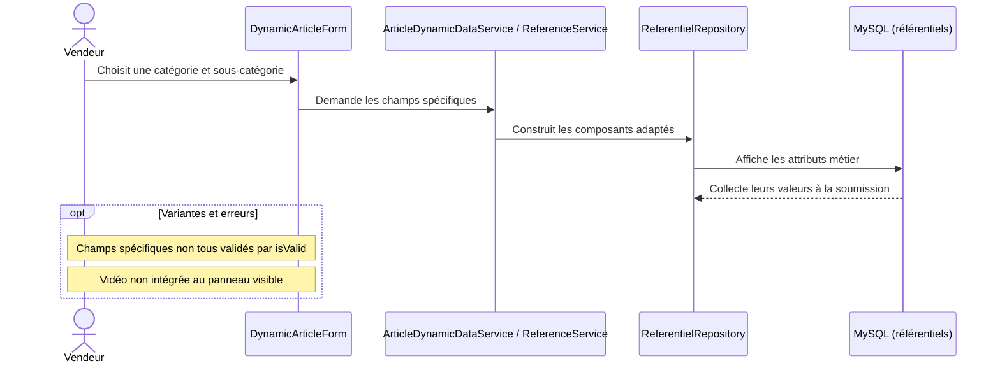
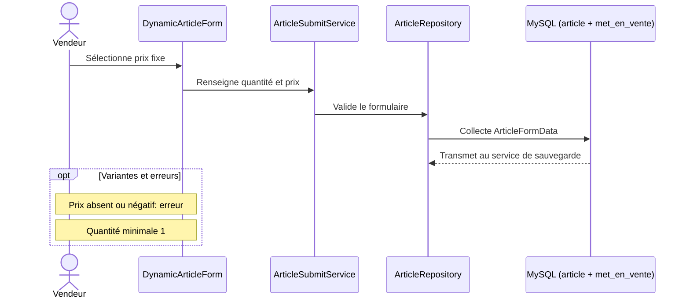
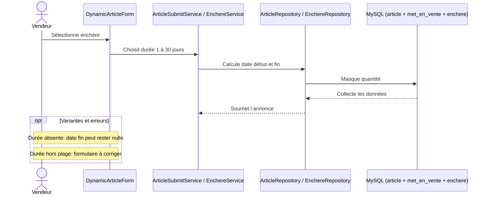
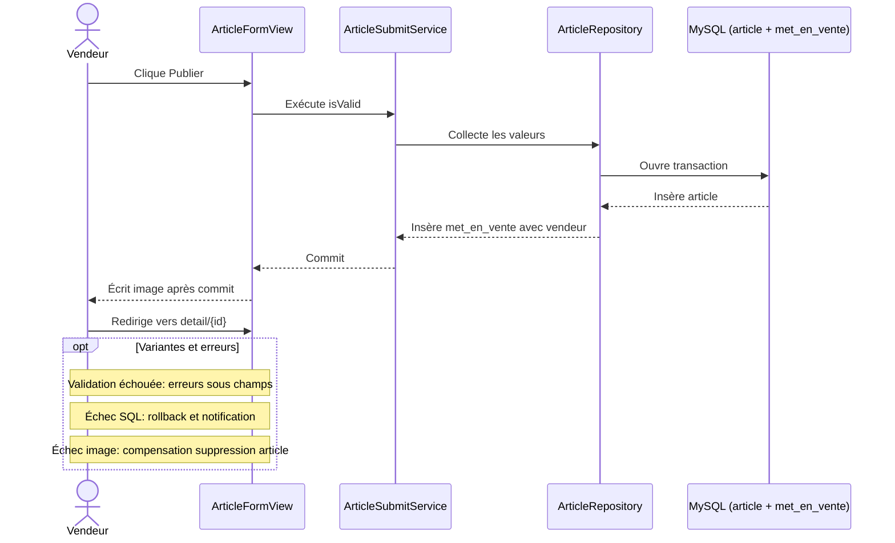
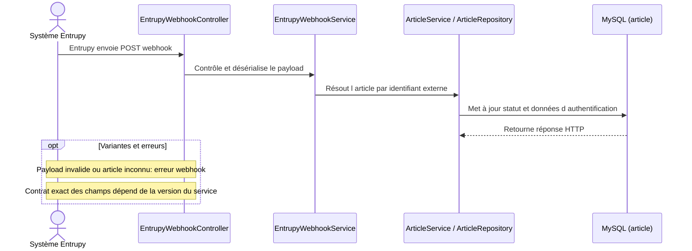

# 04 Publication Promotion

[← Index des diagrammes](./README.md)

## D21 — Ouvrir le formulaire de publication

**Résultat attendu :** ouvrir le formulaire de publication selon le scénario décrit.

## D22 — Renseigner les champs communs d une annonce

**Résultat attendu :** renseigner les champs communs d une annonce selon le scénario décrit.

## D23 — Afficher les champs dynamiques par catégorie

**Résultat attendu :** afficher les champs dynamiques par catégorie selon le scénario décrit.

## D24 — Configurer une vente à prix fixe

**Résultat attendu :** configurer une vente à prix fixe selon le scénario décrit.

## D25 — Configurer une vente aux enchères

**Résultat attendu :** configurer une vente aux enchères selon le scénario décrit.

## D26 — Publier une annonce standard avec transaction SQL

**Résultat attendu :** publier une annonce standard avec transaction sql selon le scénario décrit.

## D27 — Traiter le webhook Entrupy

**Résultat attendu :** traiter le webhook entrupy selon le scénario décrit.
