# 05 Compte Transactions

[← Index des diagrammes](./README.md)


## D28 — Charger le tableau de bord Mon compte

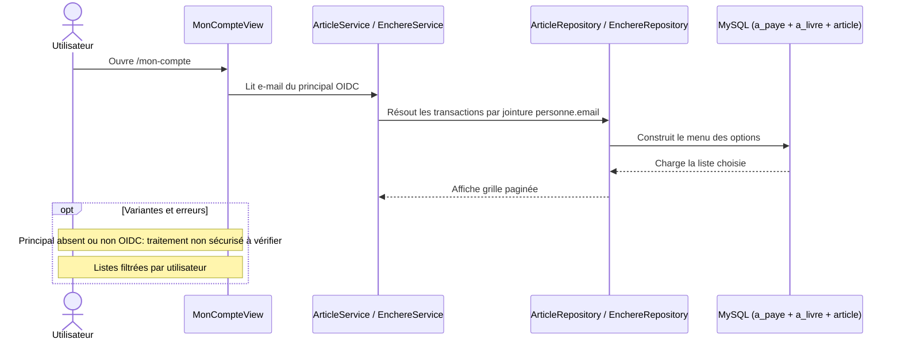

**Résultat attendu :** charger le tableau de bord mon compte selon le scénario décrit.

## D29 — Afficher les articles à payer

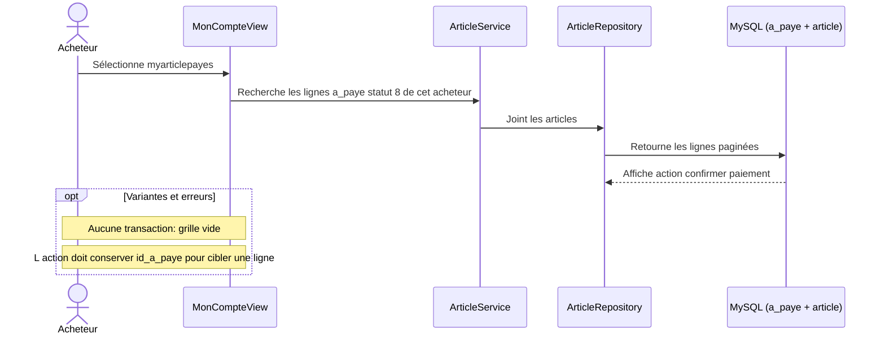

**Résultat attendu :** afficher les articles à payer selon le scénario décrit.

## D30 — Confirmer le paiement par Twint

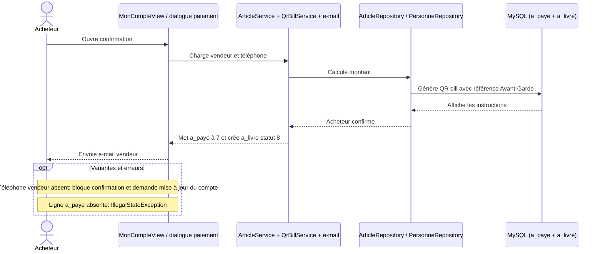

**Résultat attendu :** confirmer le paiement par twint selon le scénario décrit.

## D31 — Confirmer le paiement par virement bancaire

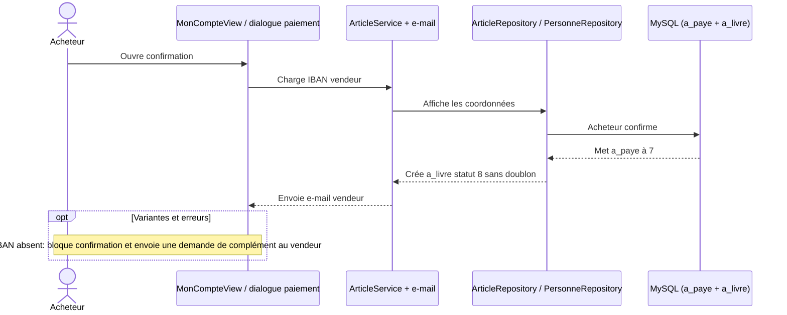

**Résultat attendu :** confirmer le paiement par virement bancaire selon le scénario décrit.

## D32 — Confirmer un paiement avec autre condition

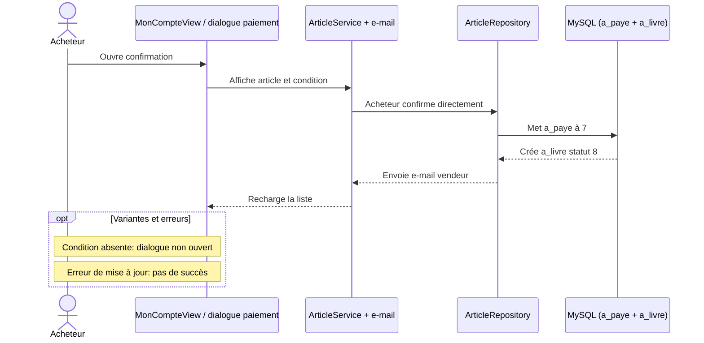

**Résultat attendu :** confirmer un paiement avec autre condition selon le scénario décrit.

## D33 — Confirmer la réception du paiement

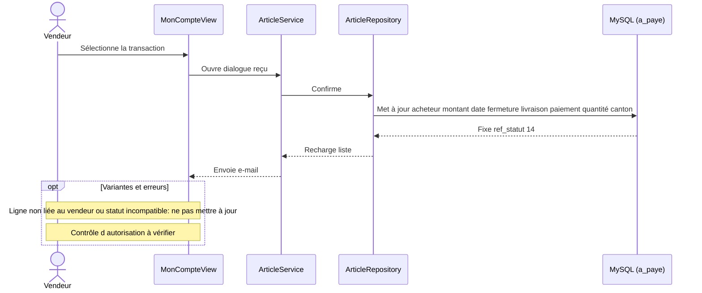

**Résultat attendu :** confirmer la réception du paiement selon le scénario décrit.

## D34 — Confirmer l expédition

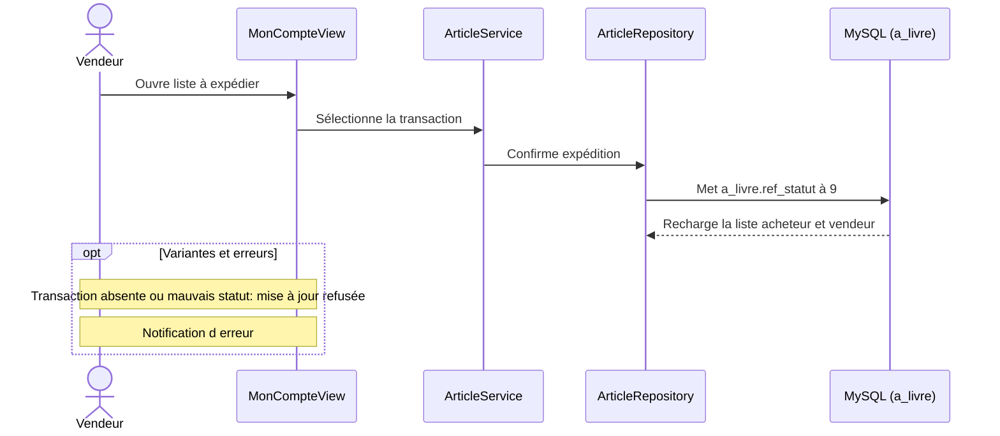

**Résultat attendu :** confirmer l expédition selon le scénario décrit.

## D35 — Confirmer la réception par l acheteur

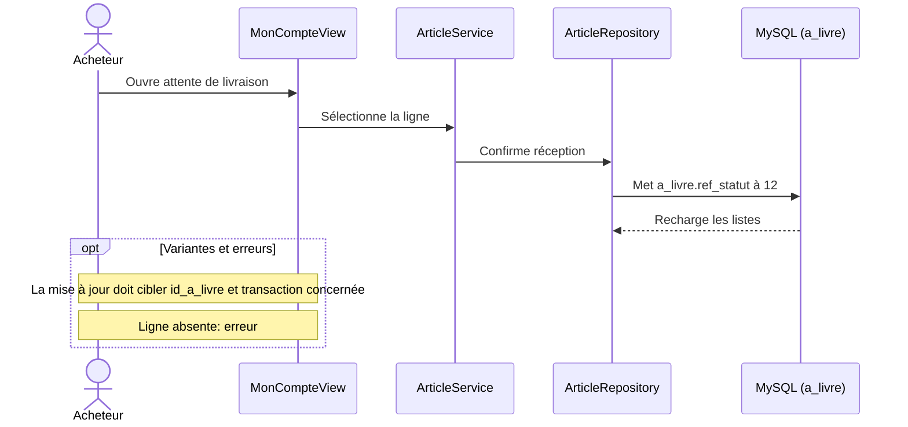

**Résultat attendu :** confirmer la réception par l acheteur selon le scénario décrit.

## D36 — Confirmer un retrait sur place

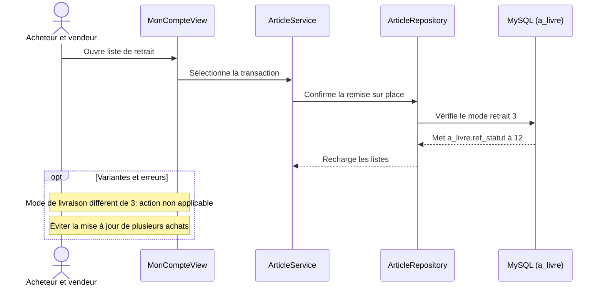

**Résultat attendu :** confirmer un retrait sur place selon le scénario décrit.

## D37 — Noter un achat

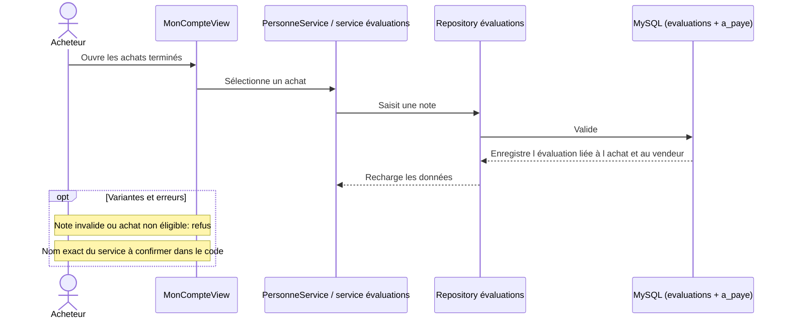

**Résultat attendu :** noter un achat selon le scénario décrit.

## D38 — Suivre ventes et achats

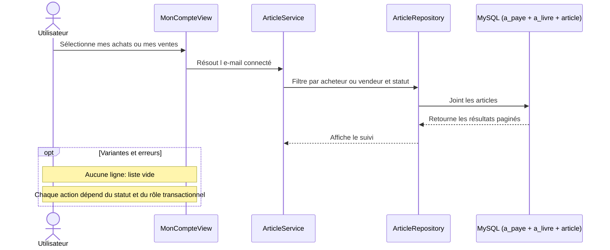

**Résultat attendu :** suivre ventes et achats selon le scénario décrit.

## D39 — Afficher les articles à livrer par poste

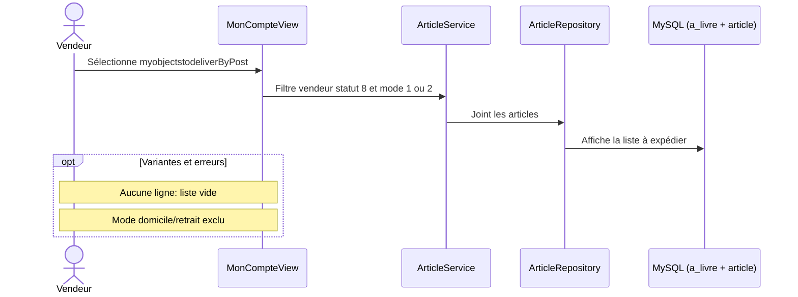

**Résultat attendu :** afficher les articles à livrer par poste selon le scénario décrit.

## D40 — Afficher les livraisons à domicile

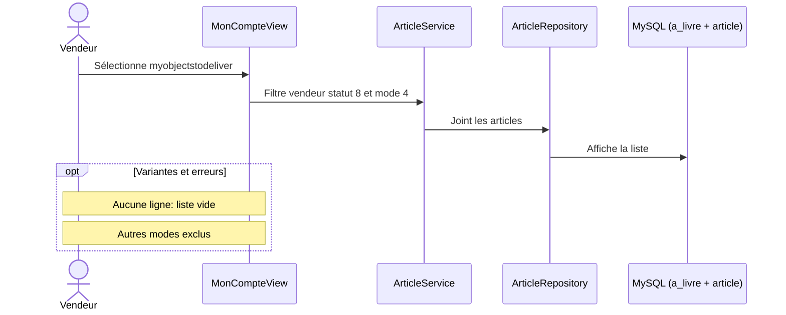

**Résultat attendu :** afficher les livraisons à domicile selon le scénario décrit.

## D41 — Suivre une livraison postale côté acheteur


**Résultat attendu :** suivre une livraison postale côté acheteur selon le scénario décrit.

## D42 — Suivre une livraison à domicile côté acheteur

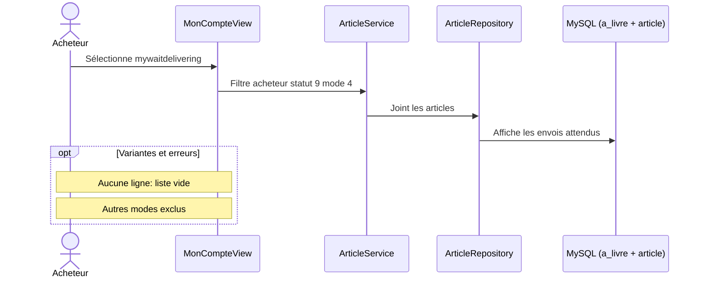

**Résultat attendu :** suivre une livraison à domicile côté acheteur selon le scénario décrit.

## D43 — Gérer les articles en attente de retrait

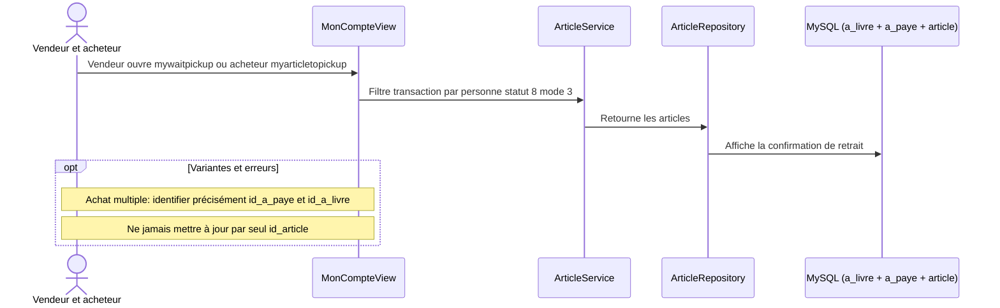

**Résultat attendu :** gérer les articles en attente de retrait selon le scénario décrit.

## D44 — Consulter les invendus

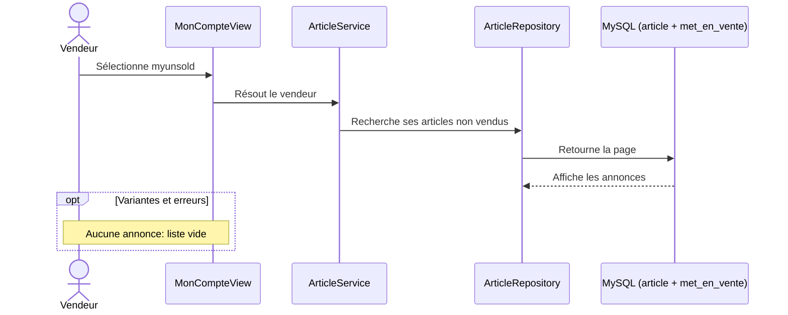

**Résultat attendu :** consulter les invendus selon le scénario décrit.

## D45 — Consulter les objets en vente

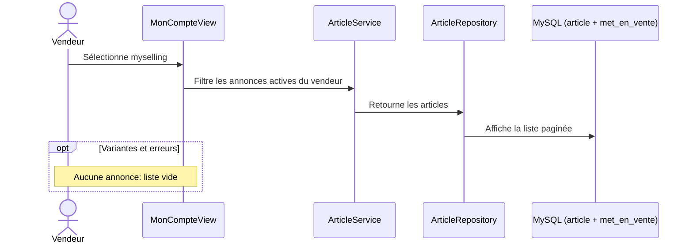

**Résultat attendu :** consulter les objets en vente selon le scénario décrit.

## D46 — Consulter les achats clôturés

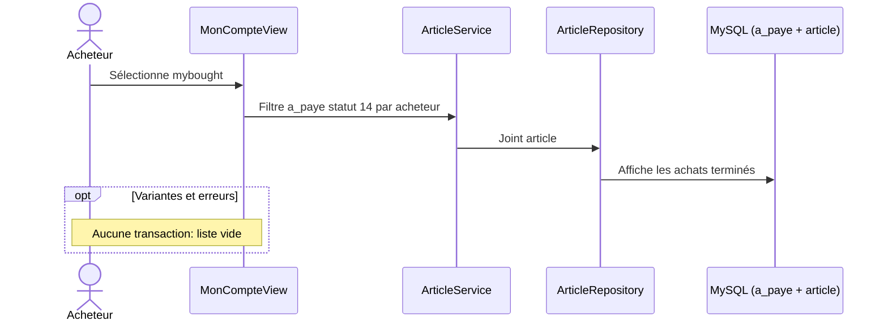

**Résultat attendu :** consulter les achats clôturés selon le scénario décrit.

## D47 — Consulter les ventes clôturées

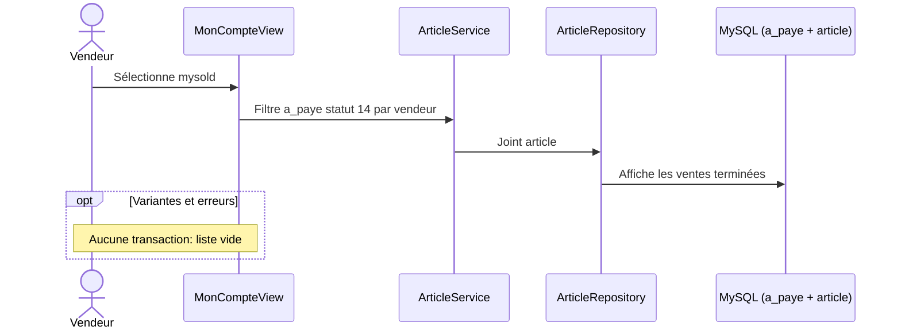

**Résultat attendu :** consulter les ventes clôturées selon le scénario décrit.

## D48 — Consulter les statistiques par marque

```mermaid
sequenceDiagram
    actor U as Utilisateur
    participant V as MonCompteView
    participant S as ArticleService
    participant R as ArticleRepository
    participant DB as MySQL (article + marque)
    U->>V: Sélectionne statdealarticlebrand
    V->>S: Demande les agrégats par marque
    S->>R: Exécute le regroupement
    R->>DB: Retourne les statistiques
    DB-->>R: Affiche les résultats
    opt Variantes et erreurs
        Note over U,V: Données absentes: statistiques vides
    end
```

**Résultat attendu :** consulter les statistiques par marque selon le scénario décrit.

## D49 — Consulter ses enchères et leurs résultats

```mermaid
sequenceDiagram
    actor U as Acheteur
    participant V as EncheresView
    participant S as EnchereService
    participant R as EnchereRepository
    participant DB as MySQL (enchere + article)
    U->>V: Ouvre /encheres
    V->>S: Résout l identité du compte
    S->>R: Charge les offres émises
    R->>DB: Joint les informations article et statut
    DB-->>R: Affiche la pagination
    opt Variantes et erreurs
        Note over U,V: Aucune enchère: liste vide
        Note over U,V: Route page invalide: page corrigée
    end
```

**Résultat attendu :** consulter ses enchères et leurs résultats selon le scénario décrit.

## D50 — Clôturer automatiquement une enchère arrivée à échéance

```mermaid
sequenceDiagram
    actor U as Système scheduler
    participant V as EnchereScheduler
    participant S as EnchereService
    participant R as EnchereRepository / ArticleRepository
    participant DB as MySQL (enchere + a_paye)
    U->>V: Déclenche le scheduler périodique
    V->>S: Recherche les enchères expirées
    S->>R: Détermine l offre gagnante
    R->>DB: Clôture l enchère
    DB-->>R: Crée la transaction a_paye en attente statut 8
    R-->>S: Déclenche les notifications prévues
    opt Variantes et erreurs
        Note over U,V: Aucune offre: traitement de l enchère sans gagnant
        Note over U,V: Erreur transaction: journalisation et reprise à définir
    end
```

**Résultat attendu :** clôturer automatiquement une enchère arrivée à échéance selon le scénario décrit.
