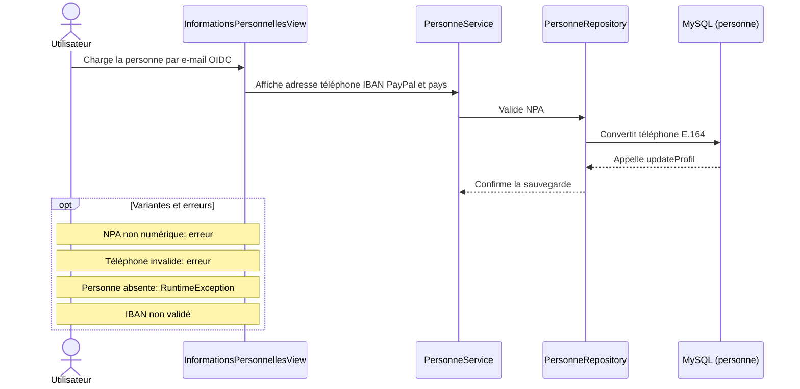
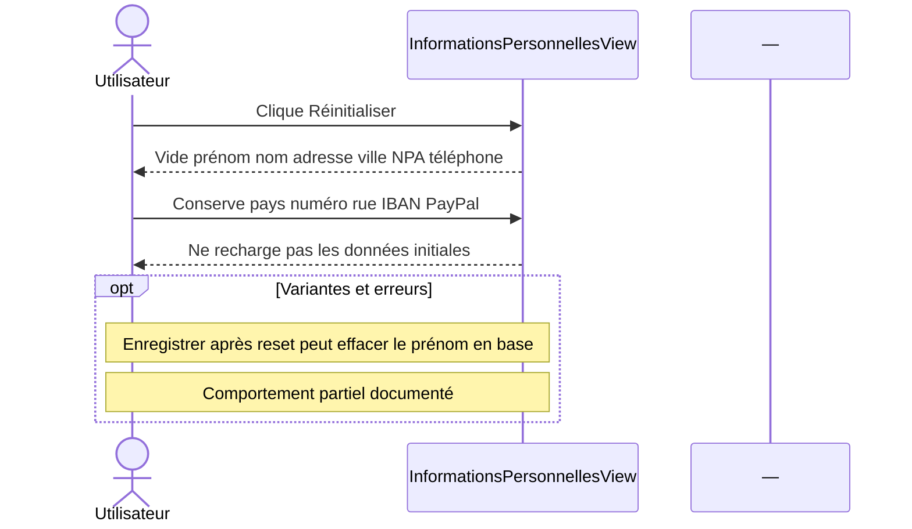
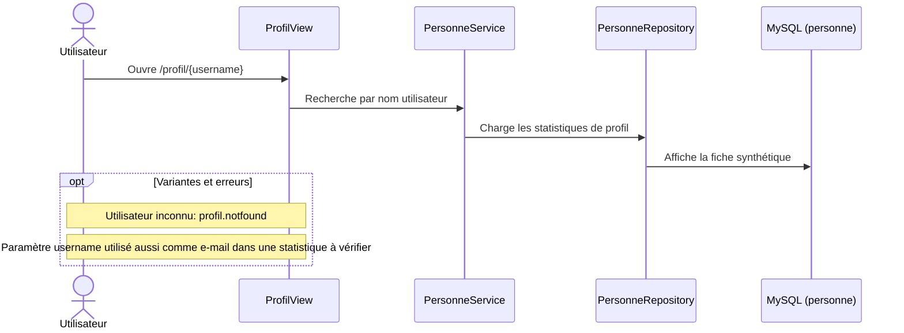
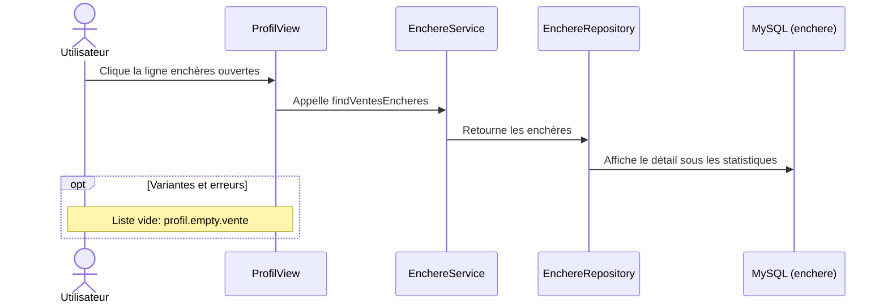
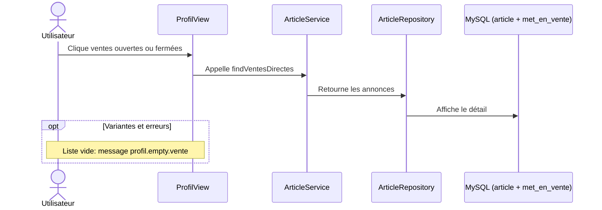

# 06 Profils Calendrier Maquettes

[← Index des diagrammes](./README.md)

## D51 — Modifier les informations personnelles

**Résultat attendu :** modifier les informations personnelles selon le scénario décrit.

## D52 — Réinitialiser certains champs du profil personnel

**Résultat attendu :** réinitialiser certains champs du profil personnel selon le scénario décrit.

## D53 — Consulter les statistiques d un profil

**Résultat attendu :** consulter les statistiques d un profil selon le scénario décrit.

## D54 — Déplier les enchères ouvertes d un profil

**Résultat attendu :** déplier les enchères ouvertes d un profil selon le scénario décrit.

## D55 — Déplier les ventes directes d un profil

**Résultat attendu :** déplier les ventes directes d un profil selon le scénario décrit.
