# Les 55 diagrammes de séquence Recordz

> Fichier consolidé — tous les diagrammes Mermaid regroupés. Voir aussi les fichiers par domaine.

## Domaine : 01-acces-navigation

## D01 — Connexion Google et création/actualisation du compte

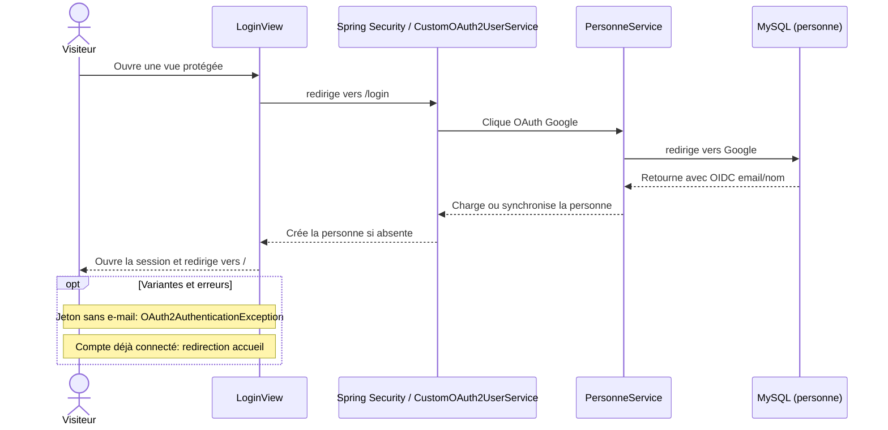

**Résultat attendu :** connexion google et création/actualisation du compte selon le scénario décrit.

## D02 — Redirection vers login depuis une vue protégée

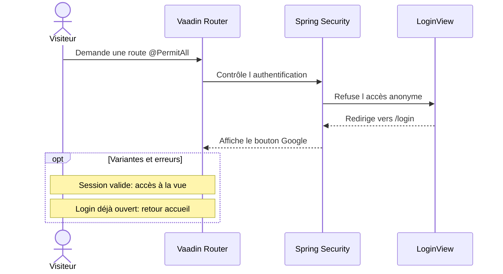

**Résultat attendu :** redirection vers login depuis une vue protégée selon le scénario décrit.

## D03 — Changer la langue de l interface

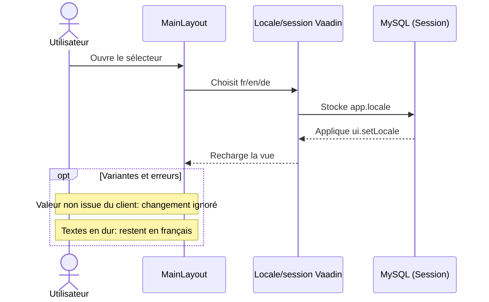

**Résultat attendu :** changer la langue de l interface selon le scénario décrit.

## D04 — Recherche depuis la barre de navigation

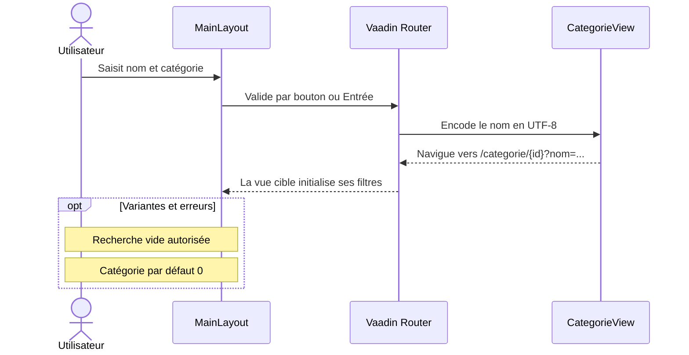

**Résultat attendu :** recherche depuis la barre de navigation selon le scénario décrit.

## D05 — Afficher la page d accueil et ses annonces

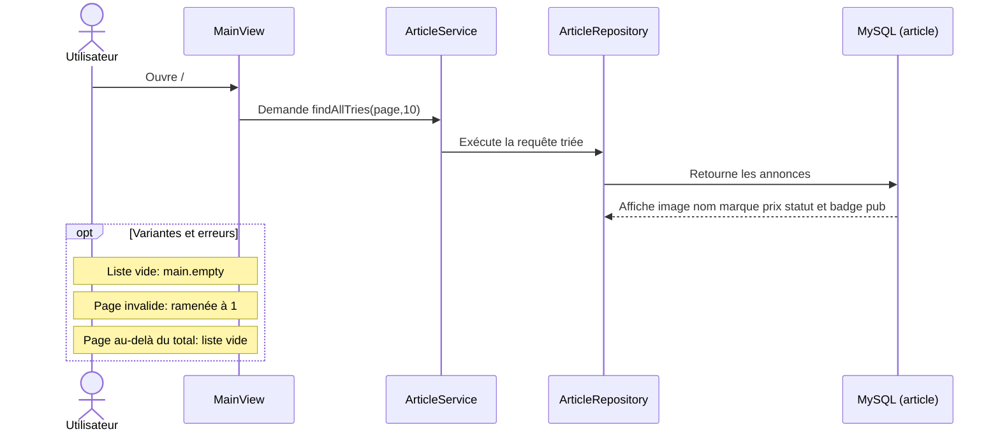

**Résultat attendu :** afficher la page d accueil et ses annonces selon le scénario décrit.

## D06 — Paginer les annonces de l accueil

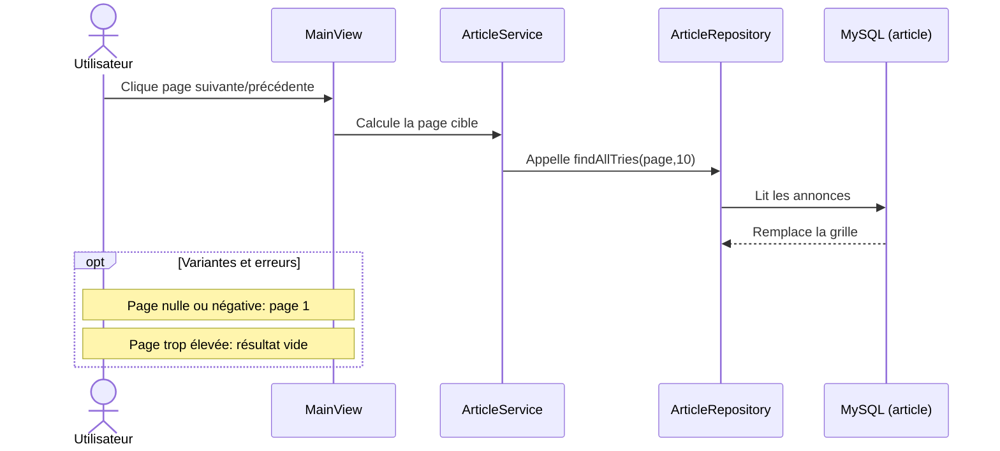

**Résultat attendu :** paginer les annonces de l accueil selon le scénario décrit.

## D07 — Consulter À propos

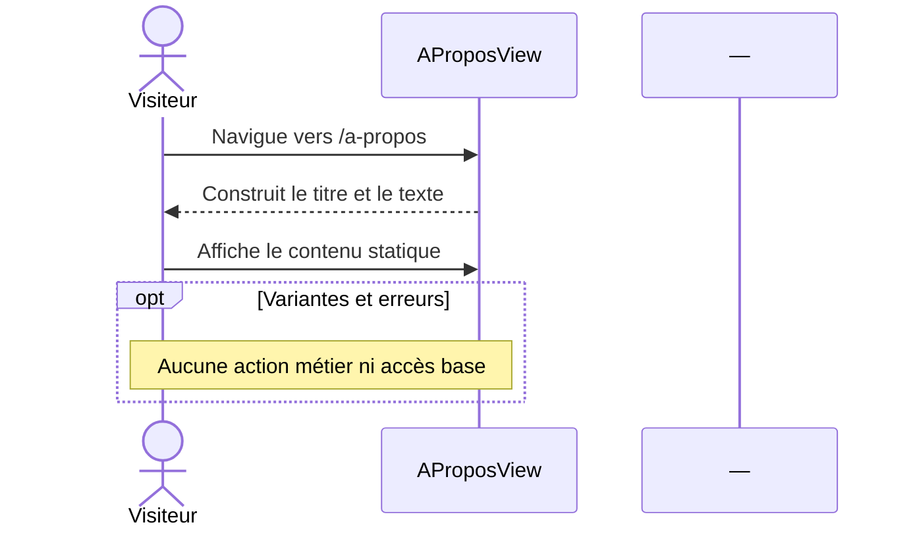

**Résultat attendu :** consulter à propos selon le scénario décrit.
## Domaine : 02-catalogue-recherche

## D08 — Parcourir les annonces par catégorie

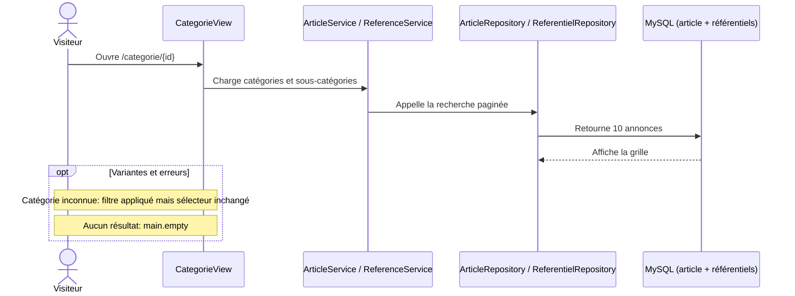

**Résultat attendu :** parcourir les annonces par catégorie selon le scénario décrit.

## D09 — Changer la catégorie et réinitialiser la sous-catégorie

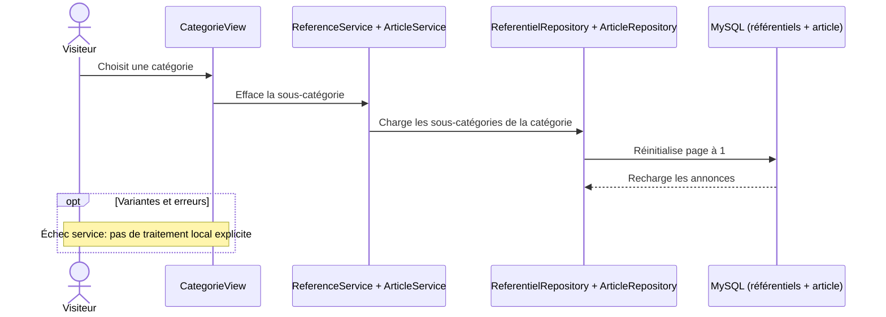

**Résultat attendu :** changer la catégorie et réinitialiser la sous-catégorie selon le scénario décrit.

## D10 — Filtrer par sous-catégorie

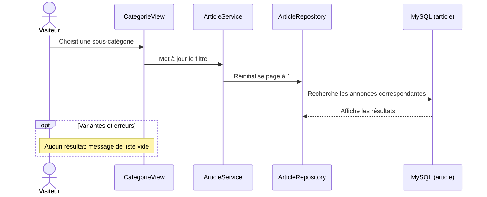

**Résultat attendu :** filtrer par sous-catégorie selon le scénario décrit.

## D11 — Paginer les résultats par catégorie

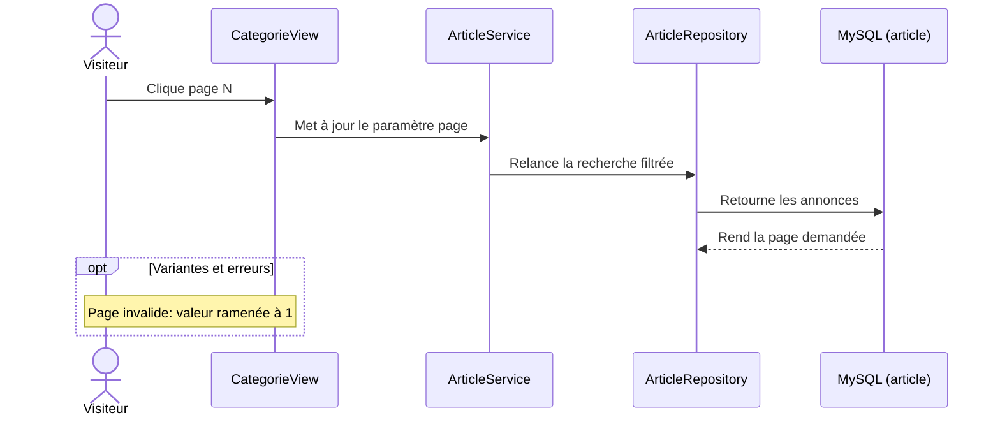

**Résultat attendu :** paginer les résultats par catégorie selon le scénario décrit.

## D12 — Recherche avancée multicritère

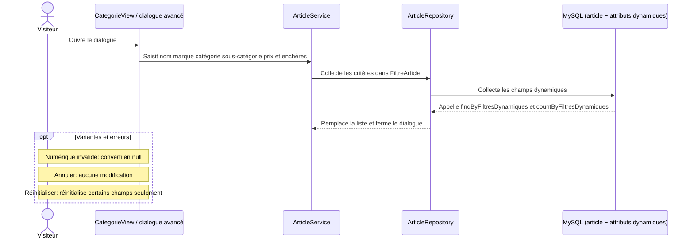

**Résultat attendu :** recherche avancée multicritère selon le scénario décrit.

## D13 — Recherche avancée avec attributs spécifiques de catégorie

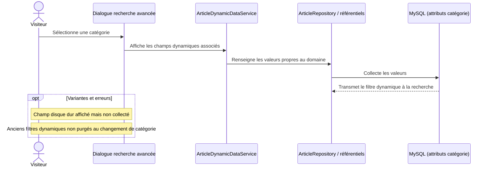

**Résultat attendu :** recherche avancée avec attributs spécifiques de catégorie selon le scénario décrit.
## Domaine : 03-fiche-article-offres

## D14 — Consulter une fiche article et enregistrer la visite

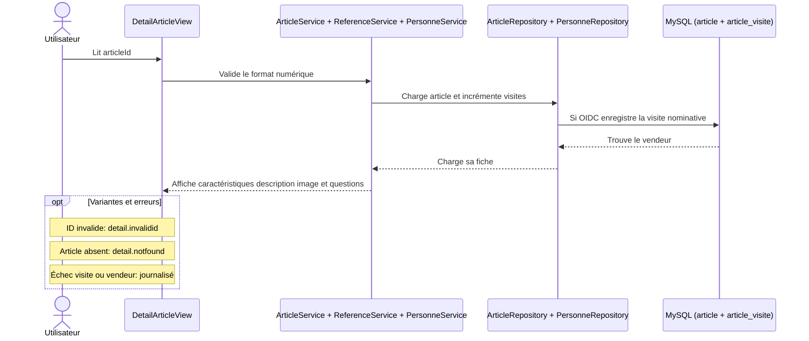

**Résultat attendu :** consulter une fiche article et enregistrer la visite selon le scénario décrit.

## D15 — Afficher les derniers enchérisseurs

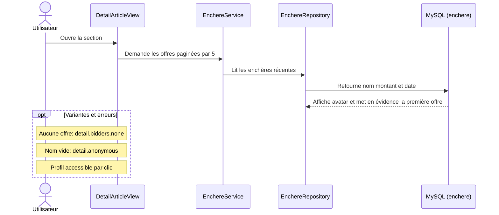

**Résultat attendu :** afficher les derniers enchérisseurs selon le scénario décrit.

## D16 — Consulter les visiteurs d un article

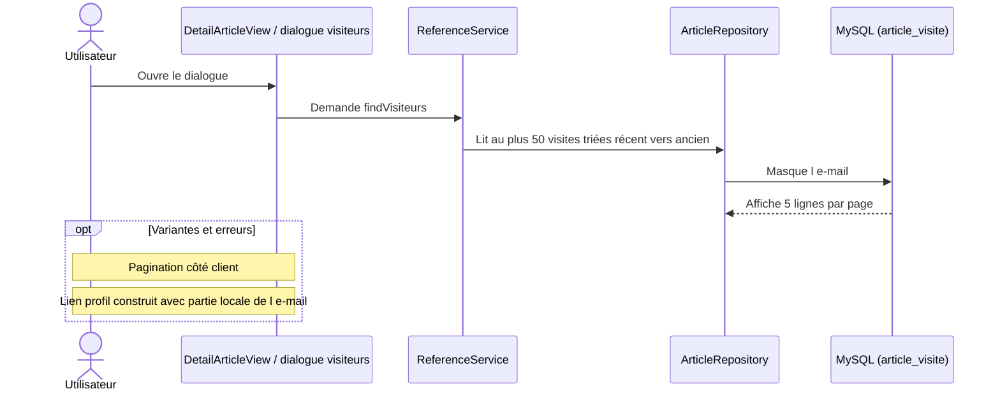

**Résultat attendu :** consulter les visiteurs d un article selon le scénario décrit.

## D17 — Poser une question sur un article

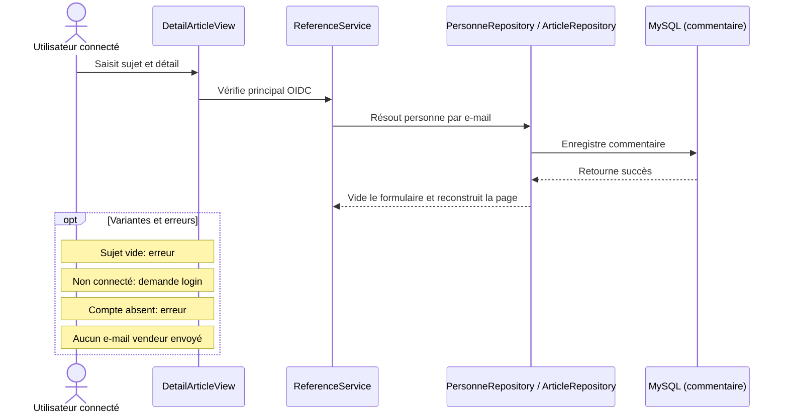

**Résultat attendu :** poser une question sur un article selon le scénario décrit.

## D18 — Valider les règles d une offre

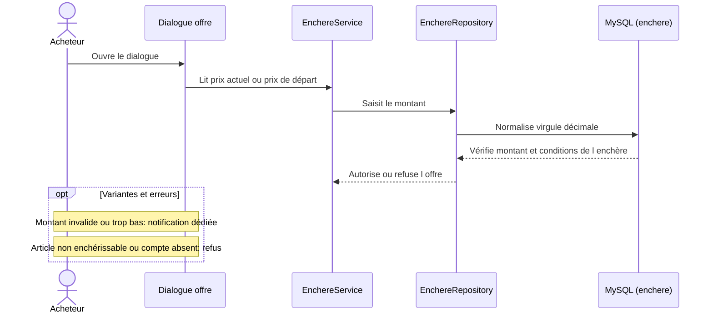

**Résultat attendu :** valider les règles d une offre selon le scénario décrit.

## D19 — Enregistrer une offre valide

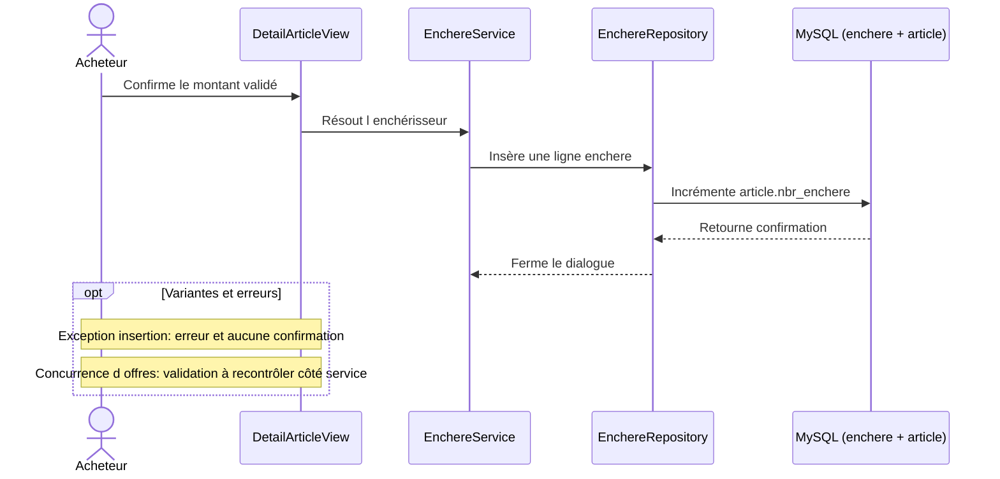

**Résultat attendu :** enregistrer une offre valide selon le scénario décrit.

## D20 — Acheter directement un article

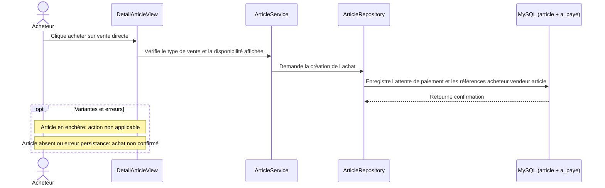

**Résultat attendu :** acheter directement un article selon le scénario décrit.
## Domaine : 04-publication-promotion

## D21 — Ouvrir le formulaire de publication

```mermaid
sequenceDiagram
    actor U as Vendeur
    participant V as ArticleFormView
    participant S as AuthenticatedUser / PersonneService
    participant R as PersonneRepository
    participant DB as MySQL (personne)
    U->>V: Ouvre /ajouter-article
    V->>S: Vérifie session OIDC et e-mail
    S->>R: Construit DynamicArticleForm
    R->>DB: Charge référentiels de catégories et conditions
    DB-->>R: Affiche le formulaire
    opt Variantes et erreurs
        Note over U,V: Compte personne absent: publication non initialisable
        Note over U,V: Route protégée pour anonyme
    end
```

**Résultat attendu :** ouvrir le formulaire de publication selon le scénario décrit.

## D22 — Renseigner les champs communs d une annonce

```mermaid
sequenceDiagram
    actor U as Vendeur
    participant V as DynamicArticleForm
    participant S as ArticleSubmitService
    U->>V: Saisit nom description prix condition paiement livraison état quantité
    V->>S: Téléverse une image
    S-->>V: Contrôle format image et taille
    V-->>U: Conserve les données du formulaire
    opt Variantes et erreurs
        Note over U,V: Formats autorisés jpeg png gif webp
        Note over U,V: Taille max 1 Mo
        Note over U,V: Nom catégorie prix obligatoires vérifiés à la validation
    end
```

**Résultat attendu :** renseigner les champs communs d une annonce selon le scénario décrit.

## D23 — Afficher les champs dynamiques par catégorie

```mermaid
sequenceDiagram
    actor U as Vendeur
    participant V as DynamicArticleForm
    participant S as ArticleDynamicDataService / ReferenceService
    participant R as ReferentielRepository
    participant DB as MySQL (référentiels)
    U->>V: Choisit une catégorie et sous-catégorie
    V->>S: Demande les champs spécifiques
    S->>R: Construit les composants adaptés
    R->>DB: Affiche les attributs métier
    DB-->>R: Collecte leurs valeurs à la soumission
    opt Variantes et erreurs
        Note over U,V: Champs spécifiques non tous validés par isValid
        Note over U,V: Vidéo non intégrée au panneau visible
    end
```

**Résultat attendu :** afficher les champs dynamiques par catégorie selon le scénario décrit.

## D24 — Configurer une vente à prix fixe

```mermaid
sequenceDiagram
    actor U as Vendeur
    participant V as DynamicArticleForm
    participant S as ArticleSubmitService
    participant R as ArticleRepository
    participant DB as MySQL (article + met_en_vente)
    U->>V: Sélectionne prix fixe
    V->>S: Renseigne quantité et prix
    S->>R: Valide le formulaire
    R->>DB: Collecte ArticleFormData
    DB-->>R: Transmet au service de sauvegarde
    opt Variantes et erreurs
        Note over U,V: Prix absent ou négatif: erreur
        Note over U,V: Quantité minimale 1
    end
```

**Résultat attendu :** configurer une vente à prix fixe selon le scénario décrit.

## D25 — Configurer une vente aux enchères

```mermaid
sequenceDiagram
    actor U as Vendeur
    participant V as DynamicArticleForm
    participant S as ArticleSubmitService / EnchereService
    participant R as ArticleRepository / EnchereRepository
    participant DB as MySQL (article + met_en_vente + enchere)
    U->>V: Sélectionne enchère
    V->>S: Choisit durée 1 à 30 jours
    S->>R: Calcule date début et fin
    R->>DB: Masque quantité
    DB-->>R: Collecte les données
    R-->>S: Soumet l annonce
    opt Variantes et erreurs
        Note over U,V: Durée absente: date fin peut rester nulle
        Note over U,V: Durée hors plage: formulaire à corriger
    end
```

**Résultat attendu :** configurer une vente aux enchères selon le scénario décrit.

## D26 — Publier une annonce standard avec transaction SQL

```mermaid
sequenceDiagram
    actor U as Vendeur
    participant V as ArticleFormView
    participant S as ArticleSubmitService
    participant R as ArticleRepository
    participant DB as MySQL (article + met_en_vente)
    U->>V: Clique Publier
    V->>S: Exécute isValid
    S->>R: Collecte les valeurs
    R->>DB: Ouvre transaction
    DB-->>R: Insère article
    R-->>S: Insère met_en_vente avec vendeur
    S-->>V: Commit
    V-->>U: Écrit image après commit
    U->>V: Redirige vers detail/{id}
    opt Variantes et erreurs
        Note over U,V: Validation échouée: erreurs sous champs
        Note over U,V: Échec SQL: rollback et notification
        Note over U,V: Échec image: compensation suppression article
    end
```

**Résultat attendu :** publier une annonce standard avec transaction sql selon le scénario décrit.

## D27 — Traiter le webhook Entrupy

```mermaid
sequenceDiagram
    actor U as Système Entrupy
    participant V as EntrupyWebhookController
    participant S as EntrupyWebhookService
    participant R as ArticleService / ArticleRepository
    participant DB as MySQL (article)
    U->>V: Entrupy envoie POST webhook
    V->>S: Contrôle et désérialise le payload
    S->>R: Résout l article par identifiant externe
    R->>DB: Met à jour statut et données d authentification
    DB-->>R: Retourne réponse HTTP
    opt Variantes et erreurs
        Note over U,V: Payload invalide ou article inconnu: erreur webhook
        Note over U,V: Contrat exact des champs dépend de la version du service
    end
```

**Résultat attendu :** traiter le webhook entrupy selon le scénario décrit.
## Domaine : 05-compte-transactions

## D28 — Charger le tableau de bord Mon compte

```mermaid
sequenceDiagram
    actor U as Utilisateur
    participant V as MonCompteView
    participant S as ArticleService / EnchereService
    participant R as ArticleRepository / EnchereRepository
    participant DB as MySQL (a_paye + a_livre + article)
    U->>V: Ouvre /mon-compte
    V->>S: Lit e-mail du principal OIDC
    S->>R: Résout les transactions par jointure personne.email
    R->>DB: Construit le menu des options
    DB-->>R: Charge la liste choisie
    R-->>S: Affiche grille paginée
    opt Variantes et erreurs
        Note over U,V: Principal absent ou non OIDC: traitement non sécurisé à vérifier
        Note over U,V: Listes filtrées par utilisateur
    end
```

**Résultat attendu :** charger le tableau de bord mon compte selon le scénario décrit.

## D29 — Afficher les articles à payer

```mermaid
sequenceDiagram
    actor U as Acheteur
    participant V as MonCompteView
    participant S as ArticleService
    participant R as ArticleRepository
    participant DB as MySQL (a_paye + article)
    U->>V: Sélectionne myarticlepayes
    V->>S: Recherche les lignes a_paye statut 8 de cet acheteur
    S->>R: Joint les articles
    R->>DB: Retourne les lignes paginées
    DB-->>R: Affiche action confirmer paiement
    opt Variantes et erreurs
        Note over U,V: Aucune transaction: grille vide
        Note over U,V: L action doit conserver id_a_paye pour cibler une ligne
    end
```

**Résultat attendu :** afficher les articles à payer selon le scénario décrit.

## D30 — Confirmer le paiement par Twint

```mermaid
sequenceDiagram
    actor U as Acheteur
    participant V as MonCompteView / dialogue paiement
    participant S as ArticleService + QrBillService + e-mail
    participant R as ArticleRepository / PersonneRepository
    participant DB as MySQL (a_paye + a_livre)
    U->>V: Ouvre confirmation
    V->>S: Charge vendeur et téléphone
    S->>R: Calcule montant
    R->>DB: Génère QR bill avec référence Avant-Garde #{id}
    DB-->>R: Affiche les instructions
    R-->>S: Acheteur confirme
    S-->>V: Met a_paye à 7 et crée a_livre statut 8
    V-->>U: Envoie e-mail vendeur
    opt Variantes et erreurs
        Note over U,V: Téléphone vendeur absent: bloque confirmation et demande mise à jour du compte
        Note over U,V: Ligne a_paye absente: IllegalStateException
    end
```

**Résultat attendu :** confirmer le paiement par twint selon le scénario décrit.

## D31 — Confirmer le paiement par virement bancaire

```mermaid
sequenceDiagram
    actor U as Acheteur
    participant V as MonCompteView / dialogue paiement
    participant S as ArticleService + e-mail
    participant R as ArticleRepository / PersonneRepository
    participant DB as MySQL (a_paye + a_livre)
    U->>V: Ouvre confirmation
    V->>S: Charge IBAN vendeur
    S->>R: Affiche les coordonnées
    R->>DB: Acheteur confirme
    DB-->>R: Met a_paye à 7
    R-->>S: Crée a_livre statut 8 sans doublon
    S-->>V: Envoie e-mail vendeur
    opt Variantes et erreurs
        Note over U,V: IBAN absent: bloque confirmation et envoie une demande de complément au vendeur
    end
```

**Résultat attendu :** confirmer le paiement par virement bancaire selon le scénario décrit.

## D32 — Confirmer un paiement avec autre condition

```mermaid
sequenceDiagram
    actor U as Acheteur
    participant V as MonCompteView / dialogue paiement
    participant S as ArticleService + e-mail
    participant R as ArticleRepository
    participant DB as MySQL (a_paye + a_livre)
    U->>V: Ouvre confirmation
    V->>S: Affiche article et condition
    S->>R: Acheteur confirme directement
    R->>DB: Met a_paye à 7
    DB-->>R: Crée a_livre statut 8
    R-->>S: Envoie e-mail vendeur
    S-->>V: Recharge la liste
    opt Variantes et erreurs
        Note over U,V: Condition absente: dialogue non ouvert
        Note over U,V: Erreur de mise à jour: pas de succès
    end
```

**Résultat attendu :** confirmer un paiement avec autre condition selon le scénario décrit.

## D33 — Confirmer la réception du paiement

```mermaid
sequenceDiagram
    actor U as Vendeur
    participant V as MonCompteView
    participant S as ArticleService
    participant R as ArticleRepository
    participant DB as MySQL (a_paye)
    U->>V: Sélectionne la transaction
    V->>S: Ouvre dialogue reçu
    S->>R: Confirme
    R->>DB: Met à jour acheteur montant date fermeture livraison paiement quantité canton
    DB-->>R: Fixe ref_statut 14
    R-->>S: Recharge liste
    S-->>V: Envoie e-mail
    opt Variantes et erreurs
        Note over U,V: Ligne non liée au vendeur ou statut incompatible: ne pas mettre à jour
        Note over U,V: Contrôle d autorisation à vérifier
    end
```

**Résultat attendu :** confirmer la réception du paiement selon le scénario décrit.

## D34 — Confirmer l expédition

```mermaid
sequenceDiagram
    actor U as Vendeur
    participant V as MonCompteView
    participant S as ArticleService
    participant R as ArticleRepository
    participant DB as MySQL (a_livre)
    U->>V: Ouvre liste à expédier
    V->>S: Sélectionne la transaction
    S->>R: Confirme expédition
    R->>DB: Met a_livre.ref_statut à 9
    DB-->>R: Recharge la liste acheteur et vendeur
    opt Variantes et erreurs
        Note over U,V: Transaction absente ou mauvais statut: mise à jour refusée
        Note over U,V: Notification d erreur
    end
```

**Résultat attendu :** confirmer l expédition selon le scénario décrit.

## D35 — Confirmer la réception par l acheteur

```mermaid
sequenceDiagram
    actor U as Acheteur
    participant V as MonCompteView
    participant S as ArticleService
    participant R as ArticleRepository
    participant DB as MySQL (a_livre)
    U->>V: Ouvre attente de livraison
    V->>S: Sélectionne la ligne
    S->>R: Confirme réception
    R->>DB: Met a_livre.ref_statut à 12
    DB-->>R: Recharge les listes
    opt Variantes et erreurs
        Note over U,V: La mise à jour doit cibler id_a_livre et transaction concernée
        Note over U,V: Ligne absente: erreur
    end
```

**Résultat attendu :** confirmer la réception par l acheteur selon le scénario décrit.

## D36 — Confirmer un retrait sur place

```mermaid
sequenceDiagram
    actor U as Acheteur et vendeur
    participant V as MonCompteView
    participant S as ArticleService
    participant R as ArticleRepository
    participant DB as MySQL (a_livre)
    U->>V: Ouvre liste de retrait
    V->>S: Sélectionne la transaction
    S->>R: Confirme la remise sur place
    R->>DB: Vérifie le mode retrait 3
    DB-->>R: Met a_livre.ref_statut à 12
    R-->>S: Recharge les listes
    opt Variantes et erreurs
        Note over U,V: Mode de livraison différent de 3: action non applicable
        Note over U,V: Éviter la mise à jour de plusieurs achats
    end
```

**Résultat attendu :** confirmer un retrait sur place selon le scénario décrit.

## D37 — Noter un achat

```mermaid
sequenceDiagram
    actor U as Acheteur
    participant V as MonCompteView
    participant S as PersonneService / service évaluations
    participant R as Repository évaluations
    participant DB as MySQL (evaluations + a_paye)
    U->>V: Ouvre les achats terminés
    V->>S: Sélectionne un achat
    S->>R: Saisit une note
    R->>DB: Valide
    DB-->>R: Enregistre l évaluation liée à l achat et au vendeur
    R-->>S: Recharge les données
    opt Variantes et erreurs
        Note over U,V: Note invalide ou achat non éligible: refus
        Note over U,V: Nom exact du service à confirmer dans le code
    end
```

**Résultat attendu :** noter un achat selon le scénario décrit.

## D38 — Suivre ventes et achats

```mermaid
sequenceDiagram
    actor U as Utilisateur
    participant V as MonCompteView
    participant S as ArticleService
    participant R as ArticleRepository
    participant DB as MySQL (a_paye + a_livre + article)
    U->>V: Sélectionne mes achats ou mes ventes
    V->>S: Résout l e-mail connecté
    S->>R: Filtre par acheteur ou vendeur et statut
    R->>DB: Joint les articles
    DB-->>R: Retourne les résultats paginés
    R-->>S: Affiche le suivi
    opt Variantes et erreurs
        Note over U,V: Aucune ligne: liste vide
        Note over U,V: Chaque action dépend du statut et du rôle transactionnel
    end
```

**Résultat attendu :** suivre ventes et achats selon le scénario décrit.

## D39 — Afficher les articles à livrer par poste

```mermaid
sequenceDiagram
    actor U as Vendeur
    participant V as MonCompteView
    participant S as ArticleService
    participant R as ArticleRepository
    participant DB as MySQL (a_livre + article)
    U->>V: Sélectionne myobjectstodeliverByPost
    V->>S: Filtre vendeur statut 8 et mode 1 ou 2
    S->>R: Joint les articles
    R->>DB: Affiche la liste à expédier
    opt Variantes et erreurs
        Note over U,V: Aucune ligne: liste vide
        Note over U,V: Mode domicile/retrait exclu
    end
```

**Résultat attendu :** afficher les articles à livrer par poste selon le scénario décrit.

## D40 — Afficher les livraisons à domicile

```mermaid
sequenceDiagram
    actor U as Vendeur
    participant V as MonCompteView
    participant S as ArticleService
    participant R as ArticleRepository
    participant DB as MySQL (a_livre + article)
    U->>V: Sélectionne myobjectstodeliver
    V->>S: Filtre vendeur statut 8 et mode 4
    S->>R: Joint les articles
    R->>DB: Affiche la liste
    opt Variantes et erreurs
        Note over U,V: Aucune ligne: liste vide
        Note over U,V: Autres modes exclus
    end
```

**Résultat attendu :** afficher les livraisons à domicile selon le scénario décrit.

## D41 — Suivre une livraison postale côté acheteur

```mermaid
sequenceDiagram
    actor U as Acheteur
    participant V as MonCompteView
    participant S as ArticleService
    participant R as ArticleRepository
    participant DB as MySQL (a_livre + article)
    U->>V: Sélectionne mywaitdeliveringbypost
    V->>S: Filtre acheteur statut 9 modes 1 ou 2
    S->>R: Joint les articles
    R->>DB: Affiche les envois attendus
    opt Variantes et erreurs
        Note over U,V: Aucune ligne: liste vide
        Note over U,V: Statut 12 retiré de cette liste
    end
```

**Résultat attendu :** suivre une livraison postale côté acheteur selon le scénario décrit.

## D42 — Suivre une livraison à domicile côté acheteur

```mermaid
sequenceDiagram
    actor U as Acheteur
    participant V as MonCompteView
    participant S as ArticleService
    participant R as ArticleRepository
    participant DB as MySQL (a_livre + article)
    U->>V: Sélectionne mywaitdelivering
    V->>S: Filtre acheteur statut 9 mode 4
    S->>R: Joint les articles
    R->>DB: Affiche les envois attendus
    opt Variantes et erreurs
        Note over U,V: Aucune ligne: liste vide
        Note over U,V: Autres modes exclus
    end
```

**Résultat attendu :** suivre une livraison à domicile côté acheteur selon le scénario décrit.

## D43 — Gérer les articles en attente de retrait

```mermaid
sequenceDiagram
    actor U as Vendeur et acheteur
    participant V as MonCompteView
    participant S as ArticleService
    participant R as ArticleRepository
    participant DB as MySQL (a_livre + a_paye + article)
    U->>V: Vendeur ouvre mywaitpickup ou acheteur myarticletopickup
    V->>S: Filtre transaction par personne statut 8 mode 3
    S->>R: Retourne les articles
    R->>DB: Affiche la confirmation de retrait
    opt Variantes et erreurs
        Note over U,V: Achat multiple: identifier précisément id_a_paye et id_a_livre
        Note over U,V: Ne jamais mettre à jour par seul id_article
    end
```

**Résultat attendu :** gérer les articles en attente de retrait selon le scénario décrit.

## D44 — Consulter les invendus

```mermaid
sequenceDiagram
    actor U as Vendeur
    participant V as MonCompteView
    participant S as ArticleService
    participant R as ArticleRepository
    participant DB as MySQL (article + met_en_vente)
    U->>V: Sélectionne myunsold
    V->>S: Résout le vendeur
    S->>R: Recherche ses articles non vendus
    R->>DB: Retourne la page
    DB-->>R: Affiche les annonces
    opt Variantes et erreurs
        Note over U,V: Aucune annonce: liste vide
    end
```

**Résultat attendu :** consulter les invendus selon le scénario décrit.

## D45 — Consulter les objets en vente

```mermaid
sequenceDiagram
    actor U as Vendeur
    participant V as MonCompteView
    participant S as ArticleService
    participant R as ArticleRepository
    participant DB as MySQL (article + met_en_vente)
    U->>V: Sélectionne myselling
    V->>S: Filtre les annonces actives du vendeur
    S->>R: Retourne les articles
    R->>DB: Affiche la liste paginée
    opt Variantes et erreurs
        Note over U,V: Aucune annonce: liste vide
    end
```

**Résultat attendu :** consulter les objets en vente selon le scénario décrit.

## D46 — Consulter les achats clôturés

```mermaid
sequenceDiagram
    actor U as Acheteur
    participant V as MonCompteView
    participant S as ArticleService
    participant R as ArticleRepository
    participant DB as MySQL (a_paye + article)
    U->>V: Sélectionne mybought
    V->>S: Filtre a_paye statut 14 par acheteur
    S->>R: Joint article
    R->>DB: Affiche les achats terminés
    opt Variantes et erreurs
        Note over U,V: Aucune transaction: liste vide
    end
```

**Résultat attendu :** consulter les achats clôturés selon le scénario décrit.

## D47 — Consulter les ventes clôturées

```mermaid
sequenceDiagram
    actor U as Vendeur
    participant V as MonCompteView
    participant S as ArticleService
    participant R as ArticleRepository
    participant DB as MySQL (a_paye + article)
    U->>V: Sélectionne mysold
    V->>S: Filtre a_paye statut 14 par vendeur
    S->>R: Joint article
    R->>DB: Affiche les ventes terminées
    opt Variantes et erreurs
        Note over U,V: Aucune transaction: liste vide
    end
```

**Résultat attendu :** consulter les ventes clôturées selon le scénario décrit.

## D48 — Consulter les statistiques par marque

```mermaid
sequenceDiagram
    actor U as Utilisateur
    participant V as MonCompteView
    participant S as ArticleService
    participant R as ArticleRepository
    participant DB as MySQL (article + marque)
    U->>V: Sélectionne statdealarticlebrand
    V->>S: Demande les agrégats par marque
    S->>R: Exécute le regroupement
    R->>DB: Retourne les statistiques
    DB-->>R: Affiche les résultats
    opt Variantes et erreurs
        Note over U,V: Données absentes: statistiques vides
    end
```

**Résultat attendu :** consulter les statistiques par marque selon le scénario décrit.

## D49 — Consulter ses enchères et leurs résultats

```mermaid
sequenceDiagram
    actor U as Acheteur
    participant V as EncheresView
    participant S as EnchereService
    participant R as EnchereRepository
    participant DB as MySQL (enchere + article)
    U->>V: Ouvre /encheres
    V->>S: Résout l identité du compte
    S->>R: Charge les offres émises
    R->>DB: Joint les informations article et statut
    DB-->>R: Affiche la pagination
    opt Variantes et erreurs
        Note over U,V: Aucune enchère: liste vide
        Note over U,V: Route page invalide: page corrigée
    end
```

**Résultat attendu :** consulter ses enchères et leurs résultats selon le scénario décrit.

## D50 — Clôturer automatiquement une enchère arrivée à échéance

```mermaid
sequenceDiagram
    actor U as Système scheduler
    participant V as EnchereScheduler
    participant S as EnchereService
    participant R as EnchereRepository / ArticleRepository
    participant DB as MySQL (enchere + a_paye)
    U->>V: Déclenche le scheduler périodique
    V->>S: Recherche les enchères expirées
    S->>R: Détermine l offre gagnante
    R->>DB: Clôture l enchère
    DB-->>R: Crée la transaction a_paye en attente statut 8
    R-->>S: Déclenche les notifications prévues
    opt Variantes et erreurs
        Note over U,V: Aucune offre: traitement de l enchère sans gagnant
        Note over U,V: Erreur transaction: journalisation et reprise à définir
    end
```

**Résultat attendu :** clôturer automatiquement une enchère arrivée à échéance selon le scénario décrit.
## Domaine : 06-profils-calendrier-maquettes

## D51 — Modifier les informations personnelles

```mermaid
sequenceDiagram
    actor U as Utilisateur
    participant V as InformationsPersonnellesView
    participant S as PersonneService
    participant R as PersonneRepository
    participant DB as MySQL (personne)
    U->>V: Charge la personne par e-mail OIDC
    V->>S: Affiche adresse téléphone IBAN PayPal et pays
    S->>R: Valide NPA
    R->>DB: Convertit téléphone E.164
    DB-->>R: Appelle updateProfil
    R-->>S: Confirme la sauvegarde
    opt Variantes et erreurs
        Note over U,V: NPA non numérique: erreur
        Note over U,V: Téléphone invalide: erreur
        Note over U,V: Personne absente: RuntimeException
        Note over U,V: IBAN non validé
    end
```

**Résultat attendu :** modifier les informations personnelles selon le scénario décrit.

## D52 — Réinitialiser certains champs du profil personnel

```mermaid
sequenceDiagram
    actor U as Utilisateur
    participant V as InformationsPersonnellesView
    participant S as —
    U->>V: Clique Réinitialiser
    V-->>U: Vide prénom nom adresse ville NPA téléphone
    U->>V: Conserve pays numéro rue IBAN PayPal
    V-->>U: Ne recharge pas les données initiales
    opt Variantes et erreurs
        Note over U,V: Enregistrer après reset peut effacer le prénom en base
        Note over U,V: Comportement partiel documenté
    end
```

**Résultat attendu :** réinitialiser certains champs du profil personnel selon le scénario décrit.

## D53 — Consulter les statistiques d un profil

```mermaid
sequenceDiagram
    actor U as Utilisateur
    participant V as ProfilView
    participant S as PersonneService
    participant R as PersonneRepository
    participant DB as MySQL (personne)
    U->>V: Ouvre /profil/{username}
    V->>S: Recherche par nom utilisateur
    S->>R: Charge les statistiques de profil
    R->>DB: Affiche la fiche synthétique
    opt Variantes et erreurs
        Note over U,V: Utilisateur inconnu: profil.notfound
        Note over U,V: Paramètre username utilisé aussi comme e-mail dans une statistique à vérifier
    end
```

**Résultat attendu :** consulter les statistiques d un profil selon le scénario décrit.

## D54 — Déplier les enchères ouvertes d un profil

```mermaid
sequenceDiagram
    actor U as Utilisateur
    participant V as ProfilView
    participant S as EnchereService
    participant R as EnchereRepository
    participant DB as MySQL (enchere)
    U->>V: Clique la ligne enchères ouvertes
    V->>S: Appelle findVentesEncheres
    S->>R: Retourne les enchères
    R->>DB: Affiche le détail sous les statistiques
    opt Variantes et erreurs
        Note over U,V: Liste vide: profil.empty.vente
    end
```

**Résultat attendu :** déplier les enchères ouvertes d un profil selon le scénario décrit.

## D55 — Déplier les ventes directes d un profil

```mermaid
sequenceDiagram
    actor U as Utilisateur
    participant V as ProfilView
    participant S as ArticleService
    participant R as ArticleRepository
    participant DB as MySQL (article + met_en_vente)
    U->>V: Clique ventes ouvertes ou fermées
    V->>S: Appelle findVentesDirectes
    S->>R: Retourne les annonces
    R->>DB: Affiche le détail
    opt Variantes et erreurs
        Note over U,V: Liste vide: message profil.empty.vente
    end
```

**Résultat attendu :** déplier les ventes directes d un profil selon le scénario décrit.